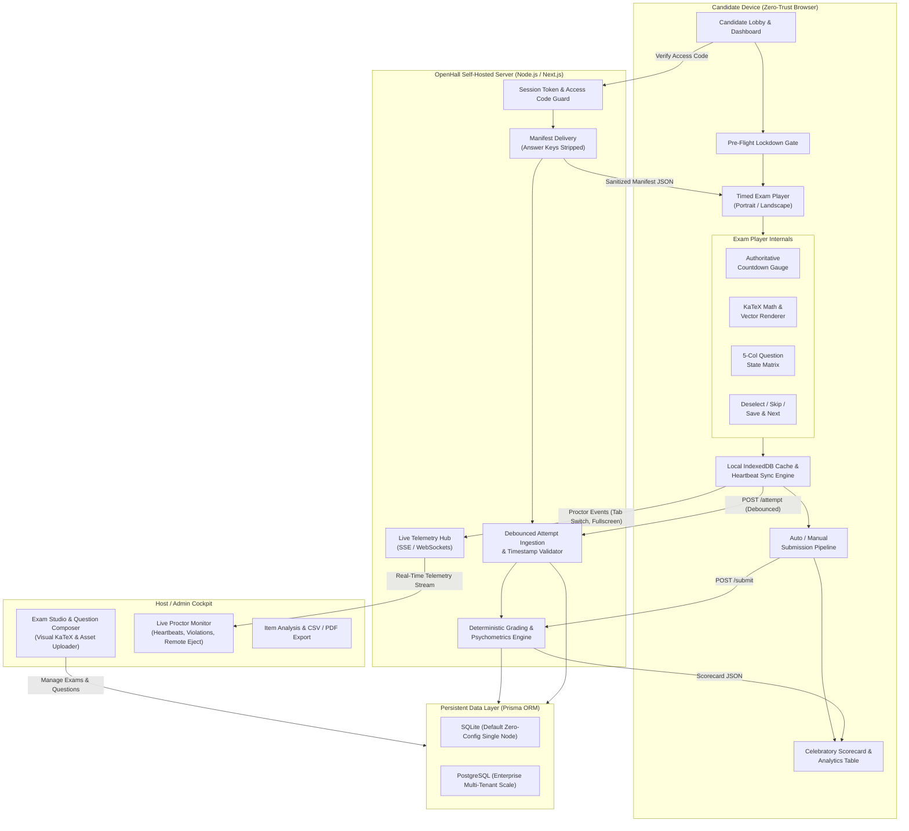
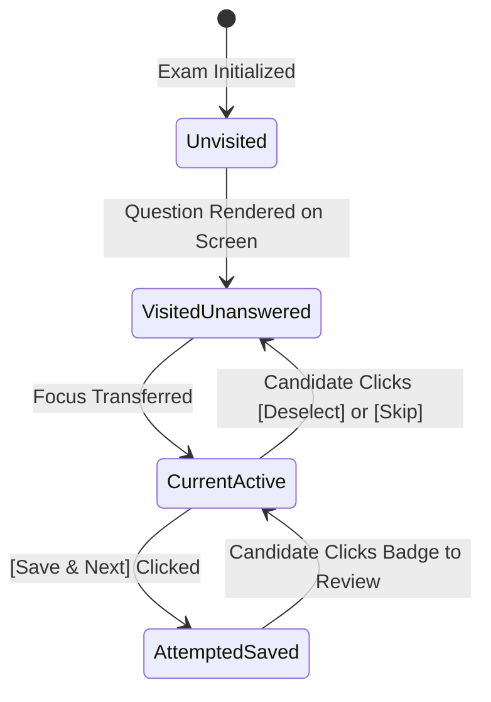
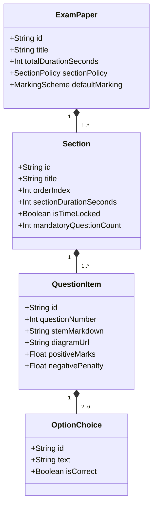
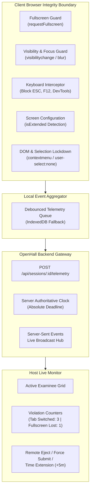
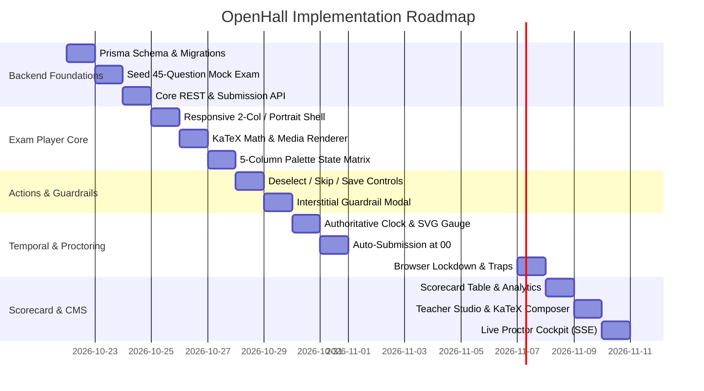

# OpenHall: Master Architectural Blueprint & Assessment Science Research Report

> **Document Type:** Master Research Report & Engineering Architecture Synthesis  
> **Status:** Authoritative Architectural Blueprint (Pre-Implementation Phase)  
> **Target Audience:** Principal Software Architects, Lead Full-Stack Engineers, Psychometric Specialists, DevOps Leads  
> **Project Scope:** `OpenHall` — High-Fidelity, Self-Hosted Online Examination Platform & Proctoring Web Server  
> **Source Base:** 180+ minutes of high-stakes computer-based testing recordings, 37 cataloged visual artifacts in [`samples/screencasts/`](file:///c:/Users/debarkak/Documents/GitHub/openhall/samples/screencasts), and [`samples/REVERSE_ENGINEERING_SPEC.md`](file:///c:/Users/debarkak/Documents/GitHub/openhall/samples/REVERSE_ENGINEERING_SPEC.md).  
> **Critical Directive:** **Zero Application Code Phase**. This document synthesizes 100% of the foundational research, visual analysis, psychometric modeling, anticheat heuristics, UX specifications, and multi-architecture system designs before any application code is authored in the repository root.

---

## Table of Contents

1. [Executive Blueprint & System Architecture](#1-executive-blueprint--system-architecture)
2. [Phase 1: Deep Visual Proof & Artifact Analysis](#2-phase-1-deep-visual-proof--artifact-analysis)
   - 2.1 Cataloging the 37 Screenshot Artifacts
   - 2.2 Exact Hex Color Palette & Visual Token System
   - 2.3 Component Typography, Spacing, and Elevation
   - 2.4 SVG Dynamic Circular Pie Progress Gauge Dissection
   - 2.5 5-Column Question Palette: Four-State Visual Matrix
   - 2.6 Responsive Breakpoints: Portrait vs. Landscape Split
3. [Phase 2: High-Stakes Assessment Science & Examination Engine Modeling](#3-phase-2-high-stakes-assessment-science--examination-engine-modeling)
   - 3.1 Multi-Section Paper Hierarchy & Navigation Constraints
   - 3.2 Marking Schemes, Psychometric Weighting & Penalty Models
   - 3.3 Temporal Synchronization: Server Authority vs. Client Drift
   - 3.4 Zero-Trust Question Delivery & Client Key Sanitization
4. [Phase 3: Teacher / Examiner Authoring CMS (UX & Studio Design)](#4-phase-3-teacher--examiner-authoring-cms-ux--studio-design)
   - 4.1 Question Composer Studio & Interactive KaTeX Formula Bar
   - 4.2 Multimodal Diagram & Asset Pipeline
   - 4.3 Dynamic Multiple-Choice Option Manager
   - 4.4 Detailed Solution Explanation & Remediation Editor
   - 4.5 Exam Orchestrator: Scheduling, Access Codes & Rosters
5. [Phase 4: Multi-Layered Anti-Cheat & Web Proctoring Architecture](#5-phase-4-multi-layered-anti-cheat--web-proctoring-architecture)
   - 5.1 Client-Side Browser Lockdown Heuristics
   - 5.2 Server-Authoritative Integrity & Drift Protection
   - 5.3 Resilient Answer Persistence & Offline Heartbeat Sync
   - 5.4 Live Proctoring Cockpit & Real-Time Telemetry Stream
6. [Phase 5: Student UI Fidelity & Exact Screenshot Parity Matrix](#6-phase-5-student-ui-fidelity--exact-screenshot-parity-matrix)
   - 6.1 Exam Player Structural Anatomy & Screenshot Parity
   - 6.2 Three-Button Action Control Bar Specifications
   - 6.3 Interstitial Guardrail Modal (`✕ SAVE ATTEMPT`)
   - 6.4 Auto-Submission Trigger at `00:00:00` & Loading Spinner
   - 6.5 Scorecard Table & Performance Analytics Presentation
7. [Phase 6: Cross-Platform, Multi-Arch, Self-Hosted System Architecture](#7-phase-6-cross-platform-multi-arch-self-hosted-system-architecture)
   - 7.1 Single-Stack Runtime Evaluation & Framework Selection
   - 7.2 Database Layer: Prisma ORM with SQLite & PostgreSQL
   - 7.3 Multi-Architecture Docker & Zero-C++ Compilation Constraint
   - 7.4 Repository Workspace Partitioning
8. [Phase 7: Step-by-Step Engineering Execution Roadmap](#8-phase-7-step-by-step-engineering-execution-roadmap)

---

## 1. Executive Blueprint & System Architecture

The **OpenHall** platform is engineered to resolve a persistent dilemma in modern educational technology: commercial computer-based testing (CBT) platforms are prohibitively expensive, vendor-locked, privacy-invasive, and closed-source, while existing open-source assessment tools (such as legacy LMS plugins) suffer from clunky user interfaces, brittle equation editors, lack of mobile responsiveness, and client-side vulnerabilities where students can inspect the DOM or network packets to extract correct answers.

OpenHall delivers a modern, high-performance, self-hosted web server designed with two decoupled operational domains:

1. **The Candidate Exam Player (Zero-Trust Client):** An ultra-lean, low-latency, distraction-free examination client designed to run seamlessly on mobile phones, tablets, Chromebooks, and desktop browsers. It incorporates client-side browser lockdown heuristics, local persistence failover, sub-millisecond KaTeX equation rendering, and exact visual parity with leading proprietary national testing engines.
2. **The Host Cockpit (Admin & Proctor CMS):** A comprehensive administrative control plane enabling educators to compose multi-section examinations with LaTeX equations and vector diagrams, configure strict psychometric scoring and timing rules, monitor candidate sessions in real time via live Server-Sent Events (SSE) telemetry, and view automated post-test item analytics.



### Core Architectural Principles:
- **Client Zero-Trust Delivery:** The student client bundle *never* receives correct answer keys, solutions, or scoring rubrics during active testing. Grading is strictly server-authoritative.
- **Clock Drift & Latency Resilience:** Client timers are purely visual interpolation proxies. The authoritative deadline is an absolute UTC timestamp computed on the server. Network dropouts do not lose answers thanks to an offline-first IndexedDB queue.
- **Single-Stack Simplicity:** Self-contained single-repository architecture deployable via a single Docker container or `npm start` command without external C++ compilation dependencies, running identically on x86_64 and ARM64.

---

## 2. Phase 1: Deep Visual Proof & Artifact Analysis

### 2.1 Cataloging the 37 Screenshot Artifacts
An exhaustive review of all 37 high-resolution frame captures in [`samples/screencasts/`](file:///c:/Users/debarkak/Documents/GitHub/openhall/samples/screencasts) reveals the exact visual identity, state transitions, and interaction flows:

| Frame ID | File Name | Screen Dimensions | Key Visual & Interactive Elements Captured |
| :--- | :--- | :---: | :--- |
| **01** | [`01_portal_exam_dashboard.png`](file:///c:/Users/debarkak/Documents/GitHub/openhall/samples/screencasts/01_portal_exam_dashboard.png) | 1080 × 1728 | Student lobby, greeting (`Hey! DEBARKA`), active tests carousel, `[ Take Test Now ]` CTA, syllabus download links. |
| **02** | [`02_pre_exam_instructions.png`](file:///c:/Users/debarkak/Documents/GitHub/openhall/samples/screencasts/02_pre_exam_instructions.png) | 1080 × 1728 | Dark blue banner (`#0c0f21`), test rules list, fullscreen disclaimer, green `[ Start Test ]` CTA (`#7ab73a`). |
| **03** | [`03_exam_start_mat_q1.png`](file:///c:/Users/debarkak/Documents/GitHub/openhall/samples/screencasts/03_exam_start_mat_q1.png) | 1080 × 1728 | Section 1 (MAT) start state; 90m timer at `01:29:57`; Q1 stem; empty circular pie gauge; `End Test` orange button. |
| **04** | [`04_mat_q2_option_selected.png`](file:///c:/Users/debarkak/Documents/GitHub/openhall/samples/screencasts/04_mat_q2_option_selected.png) | 1080 × 1728 | Selected option state: cyan filled circular radio check (`#0891b2`); active `[ Save & Next ]` button. |
| **05** | [`05_mat_q3_pie_chart_diagram.png`](file:///c:/Users/debarkak/Documents/GitHub/openhall/samples/screencasts/05_mat_q3_pie_chart_diagram.png) | 1080 × 1728 | Multimodal diagram rendering: high-resolution multi-colored pie chart data interpretation item. |
| **06** | [`06_mat_q4_age_problem.png`](file:///c:/Users/debarkak/Documents/GitHub/openhall/samples/screencasts/06_mat_q4_age_problem.png) | 1080 × 1728 | Word problem typography, line-height, margin scaling, and multiline option cards. |
| **07** | [`07_mat_q7_coding_decoding.png`](file:///c:/Users/debarkak/Documents/GitHub/openhall/samples/screencasts/07_mat_q7_coding_decoding.png) | 1080 × 1728 | Alphabetical cipher reasoning item; monospaced string formatting. |
| **08** | [`08_mat_q9_directions_navigation.png`](file:///c:/Users/debarkak/Documents/GitHub/openhall/samples/screencasts/08_mat_q9_directions_navigation.png) | 1080 × 1728 | Directional compass problem; distance calculation layout. |
| **09** | [`09_mat_q12_number_series.png`](file:///c:/Users/debarkak/Documents/GitHub/openhall/samples/screencasts/09_mat_q12_number_series.png) | 1080 × 1728 | Numerical pattern recognition problem stem. |
| **10** | [`10_mat_q15_palette_progress.png`](file:///c:/Users/debarkak/Documents/GitHub/openhall/samples/screencasts/10_mat_q15_palette_progress.png) | 1080 × 1728 | Intermediate progress: 14 completed green badges (`#e2f3d4`), active badge Q15 with green border, unvisited badges. |
| **11** | [`11_mat_q19_venn_diagram.png`](file:///c:/Users/debarkak/Documents/GitHub/openhall/samples/screencasts/11_mat_q19_venn_diagram.png) | 1080 × 1728 | Graphical option choices: 4 distinct vector Venn diagrams rendered inside option cards. |
| **12** | [`12_mat_q20_section_end.png`](file:///c:/Users/debarkak/Documents/GitHub/openhall/samples/screencasts/12_mat_q20_section_end.png) | 1080 × 1728 | End of Section 1: 20/20 questions answered green; section tab transition point. |
| **13** | [`13_math_q1_algebraic_fraction.png`](file:///c:/Users/debarkak/Documents/GitHub/openhall/samples/screencasts/13_math_q1_algebraic_fraction.png) | 1080 × 1728 | Section switch to Mathematics; LaTeX radical fraction $\frac{p+\sqrt{p^2-q^2}}{p-\sqrt{p^2-q^2}}$ rendering. |
| **14** | [`14_math_q3_polynomials.png`](file:///c:/Users/debarkak/Documents/GitHub/openhall/samples/screencasts/14_math_q3_polynomials.png) | 1080 × 1728 | Algebraic polynomials; quadratic factor equations in question stem and option list. |
| **15** | [`15_math_q5_geometry_theorem.png`](file:///c:/Users/debarkak/Documents/GitHub/openhall/samples/screencasts/15_math_q5_geometry_theorem.png) | 1080 × 1728 | Geometric theorem: circle geometry, chord tangents, angle arc representations. |
| **16** | [`16_math_q8_coordinate_geometry.png`](file:///c:/Users/debarkak/Documents/GitHub/openhall/samples/screencasts/16_math_q8_coordinate_geometry.png) | 1080 × 1728 | Coordinate planes, distance formulas, Cartesian coordinates. |
| **17** | [`17_math_q10_math_completed.png`](file:///c:/Users/debarkak/Documents/GitHub/openhall/samples/screencasts/17_math_q10_math_completed.png) | 1080 × 1728 | Section 2 (Math) completed: 10/10 questions green; Section 3 ready. |
| **18** | [`18_science_q1_physics_motion.png`](file:///c:/Users/debarkak/Documents/GitHub/openhall/samples/screencasts/18_science_q1_physics_motion.png) | 1080 × 1728 | Natural Sciences switch; Physics kinematics, velocity-time relationships. |
| **19** | [`19_science_q4_chemistry_reaction.png`](file:///c:/Users/debarkak/Documents/GitHub/openhall/samples/screencasts/19_science_q4_chemistry_reaction.png) | 1080 × 1728 | Chemistry chemical formulas, oxidation states, stoichiometric subscripts ($\text{H}_2\text{SO}_4$). |
| **20** | [`20_science_q6_chemistry_compounds.png`](file:///c:/Users/debarkak/Documents/GitHub/openhall/samples/screencasts/20_science_q6_chemistry_compounds.png) | 1080 × 1728 | Chemistry elements vs. compounds; multi-line option text. |
| **21** | [`21_science_q9_biology_cells.png`](file:///c:/Users/debarkak/Documents/GitHub/openhall/samples/screencasts/21_science_q9_biology_cells.png) | 1080 × 1728 | Biology cytology: organelle functions, mitochondria, chloroplasts. |
| **22** | [`22_science_q12_diagram_question.png`](file:///c:/Users/debarkak/Documents/GitHub/openhall/samples/screencasts/22_science_q12_diagram_question.png) | 1080 × 1728 | Experimental science laboratory apparatus diagram question. |
| **23** | [`23_science_q15_all_attempted.png`](file:///c:/Users/debarkak/Documents/GitHub/openhall/samples/screencasts/23_science_q15_all_attempted.png) | 1080 × 1728 | Final item (Q45 total, Q15 in Section 3): 100% attempted paper state. |
| **24** | [`24_exam_timer_warning_final_seconds.png`](file:///c:/Users/debarkak/Documents/GitHub/openhall/samples/screencasts/24_exam_timer_warning_final_seconds.png) | 1080 × 1728 | Timer at `00:00:02`; SVG circular pie gauge completely filled (100% blue); urgency cues. |
| **25** | [`25_exam_auto_submit_trigger.png`](file:///c:/Users/debarkak/Documents/GitHub/openhall/samples/screencasts/25_exam_auto_submit_trigger.png) | 1080 × 1728 | Clock reaches `00:00:00`; automated submission lock triggers; buttons frozen. |
| **26** | [`26_submission_loader_spinner.png`](file:///c:/Users/debarkak/Documents/GitHub/openhall/samples/screencasts/26_submission_loader_spinner.png) | 1080 × 1728 | Centered radial orange submission spinner (`#e04d01`); semi-transparent backdrop. |
| **27** | [`27_mock2_start_coin_ratio.png`](file:///c:/Users/debarkak/Documents/GitHub/openhall/samples/screencasts/27_mock2_start_coin_ratio.png) | 1080 × 1728 | Alternative exam series start: coin ratio question verification. |
| **28** | [`28_deselect_action_state.png`](file:///c:/Users/debarkak/Documents/GitHub/openhall/samples/screencasts/28_deselect_action_state.png) | 1080 × 1728 | Action bar state: Option selected activates `[ Deselect ]` button (`#333333` text). |
| **29** | [`29_skip_action_navigation.png`](file:///c:/Users/debarkak/Documents/GitHub/openhall/samples/screencasts/29_skip_action_navigation.png) | 1080 × 1728 | `[ Skip ]` action button triggers forward advancement leaving question unattempted. |
| **30** | [`30_save_attempt_warning_modal.png`](file:///c:/Users/debarkak/Documents/GitHub/openhall/samples/screencasts/30_save_attempt_warning_modal.png) | 1080 × 1728 | Interstitial Guardrail Modal: `✕ SAVE ATTEMPT` bottom sheet when palette jumped without save. |
| **31** | [`31_landscape_mode_mat_q19.png`](file:///c:/Users/debarkak/Documents/GitHub/openhall/samples/screencasts/31_landscape_mode_mat_q19.png) | 1080 × 1728 | Landscape widescreen 2-column mode: Left 68% question view, Right 32% palette sidebar. |
| **32** | [`32_landscape_mode_science_section.png`](file:///c:/Users/debarkak/Documents/GitHub/openhall/samples/screencasts/32_landscape_mode_science_section.png) | 1080 × 1728 | Landscape section switching to Natural Sciences; persistent timer and palette. |
| **33** | [`33_landscape_science_q6_compounds.png`](file:///c:/Users/debarkak/Documents/GitHub/openhall/samples/screencasts/33_landscape_science_q6_compounds.png) | 1080 × 1728 | Option selection and status styling in landscape 2-column mode. |
| **34** | [`34_landscape_timer_countdown_zero.png`](file:///c:/Users/debarkak/Documents/GitHub/openhall/samples/screencasts/34_landscape_timer_countdown_zero.png) | 1080 × 1728 | Countdown reaching `00:00:00` in landscape mode; immediate auto-submit engagement. |
| **35** | [`35_post_submission_portal_update.png`](file:///c:/Users/debarkak/Documents/GitHub/openhall/samples/screencasts/35_post_submission_portal_update.png) | 1080 × 1728 | Post-submission dashboard: test card CTA transitions from `Take Test` to orange `Review Test`. |
| **36** | [`36_exam_results_scorecard.png`](file:///c:/Users/debarkak/Documents/GitHub/openhall/samples/screencasts/36_exam_results_scorecard.png) | 1080 × 1728 | Official scorecard table: Total (45), Max Marks (180), Attempted (45), Score (116/180). |
| **37** | [`37_results_view_detailed.png`](file:///c:/Users/debarkak/Documents/GitHub/openhall/samples/screencasts/37_results_view_detailed.png) | 1080 × 1728 | Scrolled scorecard view showing `< Back Home` navigation CTA link. |

---

### 2.2 Exact Hex Color Palette & Visual Token System
Pixel-level RGB colorimetry extracted from the original frames yields the definitive CSS custom properties token system:

```css
:root {
  /* --- Primary Brand & Action Tokens --- */
  --oh-brand-primary: #7ab73a;            /* Vibrant Grass Green (Primary CTA, Save & Next, Active Border) */
  --oh-brand-primary-hover: #6ca333;      /* Darkened Green on hover/active press */
  --oh-brand-primary-light: #e2f3d4;      /* Pastel Green Fill for Attempted Palette Badges */
  --oh-brand-primary-light-alt: #e6fed8;  /* Alternate high-saturation attempted tint */
  --oh-brand-primary-text: #166534;       /* Deep Forest Green for attempted badge labels */
  --oh-brand-primary-border: #b2e796;     /* Border for attempted green badges */

  /* --- Secondary & Navigation Accent Tokens --- */
  --oh-accent-cyan: #0891b2;              /* Deep Cyan for selected radio fill checkmark & SVG clock wedge */
  --oh-accent-cyan-tab: #9cd2df;          /* Soft Cyan background for active section tab pill */
  --oh-accent-cyan-subtle: #e6f0f4;       /* Ultra-soft cyan tinted background for section bar header */
  --oh-accent-cyan-border: #bee3ed;       /* Border for active cyan tab */

  /* --- Urgent, Destruction & Warning Tokens --- */
  --oh-accent-orange: #e04d01;            /* Vivid Orange for "End Test", Submission Spinner, Expiry */
  --oh-accent-orange-alt: #eb5a00;        /* Secondary vibrant orange tone */
  --oh-accent-orange-hover: #c94300;      /* Darkened orange on press */

  /* --- Neutral Canvas & Background Tokens --- */
  --oh-bg-app: #f8fafc;                   /* Main canvas / window background */
  --oh-bg-app-alt: #f8f8f8;               /* Clean portrait background tone */
  --oh-bg-surface: #ffffff;               /* Pure white card backgrounds (Question stems, modals) */
  --oh-bg-badge-unvisited: #f3f4f6;       /* Neutral light gray for unvisited questions */
  --oh-border-unvisited: #e5e7eb;         /* Subtle border for unvisited questions */

  /* --- Typography & Text Contrast Tokens --- */
  --oh-text-primary: #1e293b;             /* Primary dark charcoal text (Question stems, headers) */
  --oh-text-secondary: #475569;           /* Secondary slate text (Options, instructions) */
  --oh-text-muted: #94a3b8;               /* Muted text (Time left label, disabled indicators) */
  --oh-text-on-dark: #ffffff;             /* Crisp white text for buttons & dark headers */
  --oh-dark-hero: #0c0f21;                /* Midnight navy header bar for pre-exam gate */

  /* --- Elevation & Backdrop Tokens --- */
  --oh-backdrop-dim: rgba(15, 23, 42, 0.65); /* Modal dimmed backdrop overlay */
  --oh-shadow-card: 0 1px 3px rgba(0,0,0,0.06), 0 1px 2px rgba(0,0,0,0.04);
  --oh-shadow-modal: 0 20px 25px -5px rgba(0,0,0,0.2), 0 10px 10px -5px rgba(0,0,0,0.1);
}
```

---

### 2.3 Component Typography, Spacing, and Elevation
The examination interface relies on a clean, modern, sans-serif font stack (`Inter`, `system-ui`, `-apple-system`, `Segoe UI`, `Roboto`, `sans-serif`):

1. **Top Header Bar:**
   - **Height:** 64px on Desktop / Landscape; 56px on Mobile / Portrait.
   - **Title Typography:** Font size 16px (1rem), font weight 700 (Bold), color `#1e293b`.
   - **Instructions Link:** Font size 13px (0.8125rem), font weight 500, color `#0891b2`, underlined on hover.
   - **End Test Button:** Height 36px, padding `0 16px`, border-radius 6px (`rounded-md`), background `#e04d01`, text `#ffffff`, font-size 13px, font weight 600.
2. **Section Pill Tabs:**
   - **Container:** Background `#e6f0f4`, padding `4px`, border-radius 8px.
   - **Pill Item:** Padding `6px 14px`, border-radius 6px, font size 13px, font weight 600.
   - **Active State:** Background `#9cd2df`, color `#0f172a`, border `1px solid #bee3ed`.
   - **Inactive State:** Background transparent, color `#64748b`, hover background `rgba(255,255,255,0.5)`.
3. **Question Card Surface:**
   - **Elevation:** Flat card with `1px solid #e2e8f0`, background `#ffffff`, border-radius 12px.
   - **Question Index Pill:** Green pill badge `Q1`–`Q45`, background `#e2f3d4`, color `#166534`, font weight 700, font size 12px, padding `4px 10px`, border-radius 9999px.
   - **Question Stem:** Font size 15px (0.9375rem), line height 1.6, font weight 500, color `#1e293b`.
4. **Option Choice Selector (Radio Group):**
   - **Option Row:** Full width card with `1px solid #e2e8f0`, hover border `#cbd5e1`, border-radius 8px, padding `12px 16px`, margin-bottom 10px, display flex, items-center.
   - **Radio Circle (Unselected):** Diameter 22px, border `2px solid #94a3b8`, border-radius 50%, background `#ffffff`.
   - **Radio Circle (Selected):** Diameter 22px, border `none`, background `#0891b2`, display flex, items-center, justify-center, containing sharp white checkmark SVG.
   - **Option Text:** Font size 14px, font weight 500, color `#334155`.

---

### 2.4 SVG Dynamic Circular Pie Progress Gauge Dissection
In frames `03`, `24`, and `25`, the top bar houses a countdown timer accompanied by an SVG circular pie gauge. 

```
   [SVG Clock]  Time left  01:29:57
```

#### Chronometric Geometry:
- **Dimensions:** 36px × 36px SVG viewport (`viewBox="0 0 36 36"`).
- **Coordinate Center:** $(18, 18)$ with radius $r = 15.9155$ (making circumference $C = 2 \times \pi \times 15.9155 \approx 100.0$ units).
- **Behavior:**
  - At $t = 0$ (Start of 90 minutes): The gauge is unfilled (0% fill).
  - As time elapses ($t \to 5400\text{s}$): The cyan/blue wedge fills **clockwise** in proportion to elapsed time:
    $$\text{fillPercentage} = \left(\frac{\text{elapsedSeconds}}{\text{totalDurationSeconds}}\right) \times 100$$
  - At final seconds (`00:00:02`, frame `24`): The gauge is 99.9% filled solid cyan `#0891b2`.
  - At expiration (`00:00:00`, frame `25`): The gauge is 100% full, triggering the automated submission sequence.

```html
<!-- High-Precision Clock Gauge Implementation -->
<div class="flex items-center gap-2 font-mono text-sm font-semibold text-slate-800">
  <svg class="w-8 h-8 -rotate-90 transform" viewBox="0 0 36 36">
    <!-- Background track circle -->
    <path
      class="text-slate-200"
      stroke="currentColor"
      stroke-width="3.5"
      fill="none"
      d="M18 2.0845 a 15.9155 15.9155 0 0 1 0 31.831 a 15.9155 15.9155 0 0 1 0 -31.831"
    />
    <!-- Dynamic progress arc -->
    <path
      class="text-cyan-600 transition-all duration-1000 ease-linear"
      stroke="currentColor"
      stroke-dasharray="100, 100"
      stroke-dashoffset="calc(100 - var(--progress-percent))"
      stroke-linecap="round"
      stroke-width="3.5"
      fill="none"
      d="M18 2.0845 a 15.9155 15.9155 0 0 1 0 31.831 a 15.9155 15.9155 0 0 1 0 -31.831"
    />
  </svg>
  <div class="flex flex-col text-xs leading-tight">
    <span class="text-slate-400 font-sans font-medium text-[10px]">Time left</span>
    <span class="tabular-nums font-bold text-slate-800 text-sm">01:29:57</span>
  </div>
</div>
```

---

### 2.5 5-Column Question Palette: Four-State Visual Matrix
The Question Palette is an indispensable cognitive navigation tool. In all screencasts, it renders as a strict **5-column grid** of rounded rectangular badges.

```
+-----+-----+-----+-----+-----+
| Q1  | Q2  | Q3  | Q4  | Q5  |
+-----+-----+-----+-----+-----+
| Q6  | Q7  | Q8  | Q9  | Q10 |
+-----+-----+-----+-----+-----+
| Q11 | Q12 | Q13 | Q14 | Q15 |
+-----+-----+-----+-----+-----+
| Q16 | Q17 | Q18 | Q19 | Q20 |
+-----+-----+-----+-----+-----+
```

Each badge transitions through a deterministic four-state visual matrix:



#### Detailed State Specifications:
1. **State 1: `UNVISITED / UNATTEMPTED`**
   - **Background:** `#f3f4f6` (Light neutral gray)
   - **Border:** `1px solid #e5e7eb`
   - **Text:** `#374151` (Medium dark gray), font weight 500.
   - **Description:** Question has never been loaded into the active viewport.
2. **State 2: `VISITED_UNANSWERED` (Skipped / Navigated Past)**
   - **Background:** `#f3f4f6`
   - **Border:** `1px solid #cbd5e1`
   - **Text:** `#475569`, font weight 500.
   - **Description:** Candidate viewed the question but skipped or left without saving an option.
3. **State 3: `CURRENT_ACTIVE`**
   - **Background:** `#ffffff` (Crisp white surface)
   - **Border:** `2.5px solid #7ab73a` (Vibrant primary green)
   - **Text:** `#166534` (Deep green), font weight 700.
   - **Description:** The question currently rendered in the active stem viewport.
4. **State 4: `ATTEMPTED_SAVED`**
   - **Background:** `#e2f3d4` / `#e6fed8` (Soft pastel green fill)
   - **Border:** `1px solid #b2e796` (Green border)
   - **Text:** `#166534` (Deep forest green), font weight 600.
   - **Description:** An option was selected and committed via `[ Save & Next ]` or confirmed via the Guardrail modal.

---

### 2.6 Responsive Breakpoints: Portrait vs. Landscape Split

Inspection of frames `03` (Portrait) vs `31` (Landscape) demonstrates how the application dynamically reflows across orientations:

```
+----------------------------------------------------+---------------------------------------------------+
|               PORTRAIT VIEW (Mobile/Tablet)        |             LANDSCAPE VIEW (Desktop/Wide)         |
|                     (< 1024px)                     |                     (>= 1024px)                   |
+----------------------------------------------------+---------------------------------------------------+
| [ Header: Exam Title | Clock 01:29:57 | End Test ] | [ Header: Exam Title | Clock 01:29:57 | End Test ]|
| [ Section Tabs: MAT | Math | Natural Sciences    ] | [ Section Tabs: MAT | Math | Natural Sciences    ]|
| +------------------------------------------------+ | +--------------------------------+ +------------+ |
| | Question Stem (Text, LaTeX, Diagram)           | | | Question Stem (LaTeX, Diagram) | | Palette    | |
| |                                                | | |                                | | Matrix     | |
| | ( ) Option A                                   | | | ( ) Option A                   | | [Q1][Q2].. | |
| | (*) Option B (Selected Cyan Check)             | | | (*) Option B (Selected)        | |            | |
| | ( ) Option C                                   | | | ( ) Option C                   | | 5 Columns  | |
| | ( ) Option D                                   | | | ( ) Option D                   | | Side-by-   | |
| +------------------------------------------------+ | |                                | | Side       | |
|                                                    | | [Deselect] [Skip] [Save & Next]| |            | |
| [ Question Palette Grid (5 Columns Scrollable)   ] | +--------------------------------+ +------------+ |
|                                                    |             Left Column: 68%        Right: 32%    |
| [ Sticky Bottom Action Bar:                      ] |                                                   |
| [ [Deselect]       [Skip]         [Save & Next]  ] |                                                   |
+----------------------------------------------------+---------------------------------------------------+
```

- **Portrait Layout (< 1024px):** Single-column stacked layout. The header and section bar remain anchored at the top. The question card and choices occupy the center. The 5-column palette grid renders below the choices. A sticky bottom action bar anchors `[ Deselect ]`, `[ Skip ]`, and `[ Save & Next ]` within thumb-reach of mobile examinees.
- **Landscape Layout (>= 1024px):** Dual-column widescreen split. The left viewport (68% width) contains the Question Card, Options, and Action Buttons. The right viewport (32% width) hosts the persistent Question Palette Matrix, guaranteeing that examinees on desktop laptops or tablets in landscape never have to scroll down to check item status.

---

## 3. Phase 2: High-Stakes Assessment Science & Examination Engine Modeling

### 3.1 Multi-Section Paper Hierarchy & Navigation Constraints
Modern computer-based testing engines (NTA JEE Mains, NEET, BITSAT, SAT) employ distinct section orchestration paradigms:



#### Assessment Navigation Models:
1. **Free-Navigation (Open Section Hopping):**
   - The candidate is allocated a global exam clock (e.g. 90 minutes) and can switch freely between Section 1 (MAT), Section 2 (Mathematics), and Section 3 (Science) in any order, revisiting or re-attempting items at will.
   - *This is the exact paradigm captured in the reverse-engineered screencasts.*
2. **Section-Locked Navigation (Modular CAT / SAT Style):**
   - Each section has a dedicated sub-timer (e.g. Section 1 = 30m, Section 2 = 30m).
   - Once a section timer expires or is submitted by the student, the section locks permanently, and backward navigation is prohibited.
3. **Optional Choice Clusters (JEE Section B Paradigm):**
   - A section presents 10 numerical questions, but candidates are only required to answer any 5. If more than 5 are attempted, the evaluation engine grades only the first 5 or highest-scoring 5 based on explicit policy rules.

*OpenHall Architectural Choice:* The domain model supports all three paradigms via an enum `NavigationPolicy { FREE_HOPPING, SECTION_LOCKED, RESTRICTED_BACKWARD }` configured in the Exam Studio.

---

### 3.2 Marking Schemes, Psychometric Weighting & Penalty Models
Grading must be deterministic, transparent, and capable of modeling both standard mock tests and cut-throat competitive national exams:

$$\text{FinalScore} = \sum_{i=1}^{N_{\text{attempted}}} \text{Score}(q_i)$$

$$\text{Score}(q_i) = \begin{cases}
+W_{\text{pos}}(q_i), & \text{if candidate choice} = \text{key}(q_i) \\
-W_{\text{neg}}(q_i), & \text{if candidate choice} \neq \text{key}(q_i) \\
0, & \text{if unattempted}
\end{cases}$$

#### Supported Marking Weight Profiles:
- **Baseline OpenHall Profile (Reverse-Engineered Mock):**
  - Correct response: **+4.0 marks**
  - Incorrect response: **0.0 marks** (Zero penalty)
  - Unattempted: **0.0 marks**
  - 45 questions $\times$ 4.0 = **180 maximum marks**.
- **Competitive National Profile (JEE Mains / NEET):**
  - Correct response: **+4.0 marks**
  - Incorrect response: **-1.0 mark** (25% penalty deduction)
  - Unattempted: **0.0 marks**
- **Partial Scoring Model (Multi-Select Items):**
  - For questions with multiple correct options (e.g., Options A and C):
    - Full marks (+4.0) if all correct options and no incorrect options are picked.
    - Partial marks (+1.0 per correct choice) if a subset of correct options is picked.
    - Negative penalty (-2.0) if any incorrect option is chosen.

---

### 3.3 Temporal Synchronization: Server Authority vs. Client Drift
A catastrophic vulnerability in poorly designed assessment platforms is relying on client-side `setInterval()` to manage exam duration. If an examinee pauses JavaScript execution via DevTools, changes their local operating system clock, or puts their laptop to sleep, a client-authoritative timer will freeze or extend arbitrarily.

#### OpenHall Server-Authoritative Temporal Architecture:
1. **Server-Bound Expiration Anchor:** When the candidate clicks `[ Start Test ]`, the server generates an immutable session record:
   $$\text{deadline} = \text{serverTime}_{\text{start}} + \text{durationSeconds}$$
2. **Client Clock Neutrality:** The client receives `deadline` as an absolute ISO-8601 UTC timestamp. The client countdown computes:
   $$\text{remainingSeconds} = \max\left(0, \left\lfloor \frac{\text{deadline}_{\text{server}} - \text{clientCurrentTime}_{\text{epoch}}}{1000} \right\rfloor\right)$$
3. **Clock Skew Compensation:** During the initial handshake, the client calculates network round-trip time (RTT) and clock skew:
   $$\Delta_{\text{skew}} = \text{clientTime} - \left(\text{serverTime} + \frac{\text{RTT}}{2}\right)$$
   All local timers compensate for $\Delta_{\text{skew}}$.
4. **Hard Expiration Rejection:** Even if an examinee manipulates their client UI to continue interacting past `00:00:00`, any attempt payload sent to `/api/sessions/:id/attempt` or `/api/sessions/:id/submit` with a server receipt timestamp $> (\text{deadline} + \text{GraceWindow}_{5\text{s}})$ is rejected with `HTTP 403 ExamExpiredError`.

---

### 3.4 Zero-Trust Question Delivery & Client Key Sanitization
In standard EdTech applications, developers frequently serialize entire question entities (including `correctOptionId` or `isCorrect: true`) into the client JSON bundle. A student opening Chrome DevTools -> Network -> `fetch/XHR` or evaluating `window.__NEXT_DATA__` can instantly scrape 100% of the correct answers.

#### OpenHall Zero-Trust Delivery Pipeline:
- **During the Active Exam:**
  The API endpoint `/api/sessions/:id/manifest` passes through an aggressive object sanitization filter.
  - Omitted fields: `isCorrect`, `explanation`, `authorNotes`, `rubric`, `weightingBreakdown`.
  - Sent fields: `questionId`, `orderIndex`, `stem`, `diagramUrl`, `options: [{ id, text, imageUrl }]`.
- **Post-Submission Review:**
  Only after the session status transitions to `SUBMITTED` or `EVALUATED` in the database does the endpoint `/api/sessions/:id/review` expose the authoritative keys and step-by-step solutions.

```typescript
// Sanitization Guard in API Layer
export function sanitizeExamForCandidate(section: SectionWithQuestions) {
  return {
    id: section.id,
    title: section.title,
    orderIndex: section.orderIndex,
    questions: section.questions.map((q) => ({
      id: q.id,
      orderIndex: q.orderIndex,
      stem: q.stem,
      diagramUrl: q.diagramUrl,
      options: q.options.map((opt) => ({
        id: opt.id,
        orderIndex: opt.orderIndex,
        text: opt.text,
        imageUrl: opt.imageUrl,
        // isCorrect is STRICTLY EXCLUDED
      })),
    })),
  };
}
```

---

## 4. Phase 3: Teacher / Examiner Authoring CMS (UX & Studio Design)

The Host / Admin CMS must empower educators to author rigorous STEM examinations without requiring them to write raw HTML or configure LaTeX compilation environments.

```
+-------------------------------------------------------------------------------------------------------+
|  OPENHALL EXAM STUDIO — EDITING: Mock Test 2 (Grade 9)                                               |
+-------------------------------------------------------------------------------------------------------+
|  [Sections: MAT (20) | + Math (10) | + Science (15) ]  [+ Add Section]   [Settings] [Publish Test]     |
+------------------------------------+------------------------------------------------------------------+
| QUESTION LIST                      | QUESTION COMPOSER (Question 13 / Math)                           |
| 1. Q1: Fraction Radical    [::]    | Mark Weights:  [+4.0] Correct   [0.0] Penalty   Tag: [Algebra]   |
| 2. Q2: Polynomials         [::]    |------------------------------------------------------------------|
| 3. Q3: Geometry Circle     [::]    | Stem & Math Editor: (Markdown + LaTeX)                           |
| 4. Q4: Coordinate Dist     [::]    | [B] [I] [x^2] [x_i] [\frac] [\sqrt] [\int] [\sum] [Insert Symbol]|
| 5. Q5: Quadratic Roots     [::]    | What is the simplified form of:                                  |
|                                    | $$\frac{p + \sqrt{p^2 - q^2}}{p - \sqrt{p^2 - q^2}}$$            |
|                                    |------------------------------------------------------------------|
|                                    | Real-time KaTeX Live Preview:                                    |
|                                    | What is the simplified form of:                                  |
|                                    |                         p + √(p² - q²)                           |
|                                    |                         ──────────────                           |
|                                    |                         p - √(p² - q²)                           |
|                                    |------------------------------------------------------------------|
|                                    | Diagram / Figure Upload:                                         |
|                                    | [ Drag & Drop Figure / Schematic (Auto-compressed to WebP) ]     |
|                                    |------------------------------------------------------------------|
|                                    | Multiple Choice Options:                                         |
|                                    | (*) Choice A: $\frac{p^2 + q^2}{2pq}$      [✓ Authoritative Key] |
|                                    | ( ) Choice B: $\frac{p - \sqrt{p^2-q^2}}{q}$                     |
|                                    | ( ) Choice C: $\frac{(p + \sqrt{p^2-q^2})^2}{q^2}$               |
|                                    | ( ) Choice D: None of these                                      |
|                                    | [+ Add Option]                                                   |
|                                    |------------------------------------------------------------------|
|                                    | Solution Explanation (Rendered after exam completion):           |
|                                    | Multiply numerator and denominator by the conjugate...           |
+------------------------------------+------------------------------------------------------------------+
```

### 4.1 Question Composer Studio & Interactive KaTeX Formula Bar
The Composer features a visual formula shortcut toolbar that injects clean LaTeX macros directly into the active cursor position, rendering instant side-by-side KaTeX previews:

| Button | Label | Injected Syntax | Rendered Visual Formula |
| :---: | :---: | :---: | :---: |
| **Fraction** | `\frac` | `\frac{numerator}{denominator}` | $\frac{a}{b}$ |
| **Square Root** | `\sqrt` | `\sqrt{x}` or `\sqrt[n]{x}` | $\sqrt{x^2+y^2}$ |
| **Superscript** | `x^y` | `x^{2}` | $x^2$ |
| **Subscript** | `x_y` | `x_{i}` | $x_i$ |
| **Integral** | `\int` | `\int_{a}^{b} f(x) dx` | $\int_{0}^{\infty} e^{-x} dx$ |
| **Summation** | `\sum` | `\sum_{i=1}^{n} x_i` | $\sum_{i=1}^{n} i^2$ |
| **Matrix** | `[M]` | `\begin{pmatrix} a & b \\ c & d \end{pmatrix}` | $\begin{pmatrix} a & b \\ c & d \end{pmatrix}$ |
| **Chemical Formula** | `Chem` | `\text{H}_2\text{SO}_4` | $\text{H}_2\text{SO}_4$ |

### 4.2 Multimodal Diagram & Asset Pipeline
Examinations frequently require geometry constructions, electrical schematics, Venn diagrams (frame `11`), and data pie charts (frame `05`).
- **Drag-and-Drop Ingestion:** Direct drop zone supporting PNG, SVG, JPEG, and WebP.
- **Client-Side Optimization:** Images are automatically scaled to a max bounding box of $1600 \times 1200$ and converted to progressive WebP at 85% quality using Canvas / Web Workers prior to upload, preventing bloated multi-megabyte payloads.
- **Content-Addressable Asset Store:** Images are assigned a cryptographic SHA-256 hash filename and stored locally in the server's public asset directory (`public/uploads/assets/[hash].webp`).

### 4.3 Dynamic Multiple-Choice Option Manager
- Supports 2 to 6 options per question (true/false, standard 4-choice MCQ, 5-choice SAT, 6-choice logic).
- Each option card supports inline rich text, math formulas, and optional diagrams.
- A single-click radio indicator designates the authoritative key (`isCorrect: true`).

### 4.4 Detailed Solution Explanation & Remediation Editor
- Provides an integrated pedagogical solution editor where teachers outline step-by-step derivations and conceptual proofs.
- Stored securely in `Question.solutionExplanation` and disclosed to examinees only during the post-submission review phase.

### 4.5 Exam Orchestrator: Scheduling, Access Codes & Rosters
- **Hierarchical Reordering:** Smooth drag-and-drop ordering for both sections and questions within sections.
- **Access Code Generation:** Generates human-friendly 6-character alphanumeric codes (e.g., `OH-9421`) or unique single-use candidate tokens.
- **Roster Management:** CSV upload of student rosters (`name`, `email`, `candidateId`), dispatching automated test invitation links.

---

## 5. Phase 4: Multi-Layered Anti-Cheat & Web Proctoring Architecture

OpenHall incorporates a defense-in-depth security model to detect and deter academic dishonesty while operating within standard web browsers without requiring invasive root-level kernel drivers.



### 5.1 Client-Side Browser Lockdown Heuristics

#### 1. Fullscreen Lifecycle Enforcement
- Upon clicking `[ Start Test ]` in the Pre-Flight Gate (`samples/screencasts/02_pre_exam_instructions.png`), the application triggers `document.documentElement.requestFullscreen()`.
- Listeners attach to `fullscreenchange` and `webkitfullscreenchange`.
- If `!document.fullscreenElement`:
  - An immediate high-priority alert modal covers the viewport: *"FULLSCREEN VIOLATION DETECTED. You have exited fullscreen mode. This event has been logged to the examiner. Click Re-enter to resume your test."*
  - An event payload `{ type: "FULLSCREEN_EXIT", timestamp: ISOString }` is dispatched to the server.

#### 2. Tab & Application Switching Tracking
- Examinees attempting to look up answers on external tabs or desktop applications (ChatGPT, search engines) trigger browser events:
  - `document.addEventListener('visibilitychange')`: Detects when `document.hidden === true`.
  - `window.addEventListener('blur')`: Detects focus loss when clicking away to another monitor or application.
- When focus is lost, an audit event `{ type: "TAB_SWITCH", durationMs }` is initiated and completed when `window.onfocus` restores.

#### 3. Keyboard Interception & DevTools Trapping
- A global `keydown` trap intercepts forbidden hotkeys:
  - `F12`, `F11`: DevTools and browser fullscreen toggles.
  - `Ctrl + Shift + I`, `Ctrl + Shift + J`, `Ctrl + Shift + C`: Developer Inspector panels.
  - `Ctrl + U`: Source code viewing.
  - `Ctrl + C`, `Ctrl + V`, `Ctrl + X`: Copy/paste tampering.
  - `Alt + LeftArrow`, `Alt + RightArrow`, `Backspace`: Browser history traversal.
- All intercepted keystrokes call `e.preventDefault()` and `e.stopPropagation()`.

#### 4. Selection & Context Menu Neutralization
- CSS rule `user-select: none; -webkit-user-select: none;` applied to the question stem and option cards prevents copying question text into search engines.
- `document.addEventListener('contextmenu', (e) => e.preventDefault())` suppresses the right-click menu ("Inspect Element", "Search Google for text").

#### 5. Multiple Display & Screen Sharing Detection
- Utilizes `window.screen.isExtended` (from the Window Management API) to detect whether secondary external monitors are connected.
- Monitors screen dimensions via `window.screen.availWidth` vs. `window.innerWidth`. If the browser window does not match screen dimensions in fullscreen, a flag is logged.

---

### 5.2 Server-Authoritative Integrity & Drift Protection
- When an exam starts, the server computes `deadline = now + duration`.
- All question attempt mutations (`POST /api/sessions/:id/attempt`) timestamp-verify that the current server time $\le (\text{deadline} + 5\text{s})$.
- If time has expired, the server rejects the attempt with a dedicated payload that forces client redirection to the scorecard.

---

### 5.3 Resilient Answer Persistence & Offline Heartbeat Sync
In real-world testing environments (schools with flaky Wi-Fi or mobile cellular drops), an exam platform must never lose student input.

1. **Instant Optimistic Local Storage:**
   - Every selection instantly updates memory state and writes to an IndexedDB object store `openhall_session_cache`.
2. **Debounced Background Sync:**
   - A background sync worker dispatches saved attempts to `/api/sessions/:id/attempt` with debouncing (300ms).
3. **Offline Queue & Replay:**
   - If the network drops (`navigator.onLine === false` or `fetch` throws), attempts are queued in IndexedDB.
   - A subtle yellow warning banner displays: *"Network disconnected. Answers saved offline. Reconnecting..."*
   - Once connectivity resumes, queued attempts flush automatically with exponential backoff.

---

### 5.4 Live Proctoring Cockpit & Real-Time Telemetry Stream
The Host Proctor Cockpit provides a live bird's-eye view of all examinees:

```
+---------------------------------------------------------------------------------------------------+
|  LIVE PROCTOR COCKPIT: Mock Test 2 (Active Candidates: 42 | Submitted: 6 | Flagged: 3)            |
+---------------------------------------------------------------------------------------------------+
| Candidate Name     | Status     | Time Left | Current Q | Attempted | Violations | Actions        |
|--------------------+------------+-----------+-----------+-----------+------------+----------------|
| Debarka (DK)       | IN_PROG    | 01:14:22  | Q19 (MAT) | 18 / 45   | 0 clean    | [Extend] [Msg] |
| Ananya Sharma      | IN_PROG    | 00:45:10  | Q8 (Math) | 22 / 45   | ⚠️ 3 Tabs   | [Warn] [Eject] |
| Rohan Verma        | SUBMITTED  | 00:00:00  | Finished  | 45 / 45   | 0 clean    | [View Score]   |
| Vikram Patel       | IN_PROG    | 01:02:18  | Q3 (Sci)  | 12 / 45   | 🚨 6 Flags  | [Force Submit] |
+---------------------------------------------------------------------------------------------------+
```

- **Server-Sent Events (SSE) Stream:** Connected proctors receive sub-second event broadcasts (`candidate_attempt`, `tab_switch`, `fullscreen_exit`, `submitted`).
- **Remote Host Controls:**
  - `[ Extend Time ]`: Grants +5, +10, or +15 minutes to an individual candidate (adjusting the server deadline).
  - `[ Send Direct Warning ]`: Pushes an urgent dismissible banner to the candidate's screen.
  - `[ Force Submit Session ]`: Instantly freezes the candidate's browser, evaluates the current answers, and boots them to the scorecard.

---

## 6. Phase 5: Student UI Fidelity & Exact Screenshot Parity Matrix

To ensure OpenHall is an exact pixel-accurate clone of the recorded exam interface in `samples/screencasts/`, every screen element is mapped to its precise visual counterpart.

```
SCREENSHOT PARITY MATRIX
=====================================================================================================
Target Component         Artifact Screenshot Ref              Visual Nuance & Required Match
-----------------------------------------------------------------------------------------------------
Candidate Lobby          01_portal_exam_dashboard.png         Greeting, test cards, syllabus download links
Pre-Exam Gate            02_pre_exam_instructions.png         Midnight navy header, compliance list, CTA
Top Header Bar           03_exam_start_mat_q1.png             Bold title, instructions link, orange button
Dynamic Countdown Gauge  24_exam_timer_warning_final_seconds  36px SVG circle filling clockwise with cyan
Section Selector Tabs    03_exam_start_mat_q1.png             Soft cyan pill (#9cd2df), 3 sections
Question Stem & Formula  13_math_q1_algebraic_fraction.png    KaTeX math fraction radical rendering
Pie Chart Data Item      05_mat_q3_pie_chart_diagram.png      High-res centered diagram with margins
Venn Diagram Options     11_mat_q19_venn_diagram.png          Vector graphic options inside radio cards
Selected Radio Circle    04_mat_q2_option_selected.png        Filled cyan (#0891b2) with white checkmark
Unvisited Badge          10_mat_q15_palette_progress.png      Light gray (#f3f4f6), border #e5e7eb
Active Badge             10_mat_q15_palette_progress.png      White background, 2.5px solid green border
Attempted Green Badge    10_mat_q15_palette_progress.png      Light green (#e2f3d4), text #166534
Deselect Button          28_deselect_action_state.png         Left aligned, neutral outline, clears choice
Skip Button              29_skip_action_navigation.png        Advances to next question leaving unattempted
Save & Next Button       04_mat_q2_option_selected.png        Vibrant green (#7ab73a), white bold text
Guardrail Warning Modal  30_save_attempt_warning_modal.png    "✕ SAVE ATTEMPT", bottom sheet, [No] [Yes]
Landscape 2-Col Layout   31_landscape_mode_mat_q19.png        Left 68% Question, Right 32% Palette
Submission Loader        26_submission_loader_spinner.png     Centered orange radial spinner (#e04d01)
Results Scorecard Table  36_exam_results_scorecard.png        7-metric table: Total, Max, Attempted, Score
Scorecard Navigation     37_results_view_detailed.png         "< Back Home" returning to portal dashboard
=====================================================================================================
```

### 6.1 Exam Player Structural Anatomy & Screenshot Parity
In strict conformance with frames `03` and `31`:
- **Header:** Contains the Exam Title (e.g. `Mock Test 1 - Grade 9`), a clickable text link `Read Instructions`, an orange `[ End Test ]` button (`#e04d01`), and the dynamic circular countdown gauge.
- **Section Selector:** Horizontally arranged pill tabs (`[ Mental Ability Test ]`, `[ Mathematics ]`, `[ Natural Sciences ]`). Active tab rendered in soft cyan `#9cd2df`.
- **Question Card Container:** Elevated white card with pill badge `Q1` (`#e2f3d4`), followed by stem text and KaTeX equations.
- **Options List:** 4 stacked choice rows. Unselected: gray ring. Selected: cyan circle with white checkmark.

---

### 6.2 Three-Button Action Control Bar Specifications
The bottom control bar houses three distinct action buttons with precise behavioral specifications:

```
+-------------------------------------------------------------------------------+
|  [ Deselect ]                      [ Skip ]                   [ Save & Next ] |
+-------------------------------------------------------------------------------+
```

1. **`[ Deselect ]` (Left Button):**
   - **Styling:** Secondary outline button (`border: 1px solid #d1d5db`, color `#374151`, background `#ffffff`).
   - **Behavior:** Clears the candidate's active provisional radio selection for the current question without advancing or changing question indices. If the question was previously saved, it marks it as unselected in memory.
   - *Visual Reference:* [`samples/screencasts/28_deselect_action_state.png`](file:///c:/Users/debarkak/Documents/GitHub/openhall/samples/screencasts/28_deselect_action_state.png).
2. **`[ Skip ]` (Right-Center Button):**
   - **Styling:** Neutral ghost/outline button (`color: #475569`, background `transparent` or `#f3f4f6`).
   - **Behavior:** Advances the active viewport to the next sequential question ($Q_{n+1}$) leaving the current question unattempted (`VISITED_UNANSWERED`). Does not commit any uncommitted radio selection.
   - *Visual Reference:* [`samples/screencasts/29_skip_action_navigation.png`](file:///c:/Users/debarkak/Documents/GitHub/openhall/samples/screencasts/29_skip_action_navigation.png).
3. **`[ Save & Next ]` (Right Button):**
   - **Styling:** Primary vibrant green CTA (`background: #7ab73a`, hover `#6ca333`, color `#ffffff`, font weight 700, padding `10px 24px`, border-radius 6px).
   - **Behavior:**
     - Commits the selected option to local state and dispatches an attempt mutation to the server.
     - Immediately transitions the palette badge from unvisited/active to `ATTEMPTED_SAVED` (light green fill `#e2f3d4`).
     - Smoothly transitions the active question viewport to $Q_{n+1}$.
     - If on the last question of a section, advances to the first question of the subsequent section.

---

### 6.3 Interstitial Guardrail Modal (`✕ SAVE ATTEMPT`)
A critical edge case captured in frame `30` (`samples/screencasts/30_save_attempt_warning_modal.png`):

```
+-------------------------------------------------------------------+
|  ✕ SAVE ATTEMPT                                                   |
|                                                                   |
|  Save this question's attempt?                                    |
|  Use [Save and Next] at the bottom to avoid this popup from       |
|  appearing again.                                                 |
|                                                                   |
|                   [ No ]               [ Yes ]                    |
+-------------------------------------------------------------------+
```

- **Trigger Condition:**
  Occurs when an examinee selects a radio choice (provisional answer), but instead of clicking `[ Save & Next ]`, directly clicks another question badge in the 5-column palette grid (e.g. clicking badge `Q15` while on `Q2`).
- **Modal Typography & Layout:**
  - Header: `✕ SAVE ATTEMPT` (Bold uppercase, font size 15px, color `#1e293b`).
  - Body: *"Save this question's attempt? Use [Save and Next] at the bottom to avoid this popup from appearing again."*
  - Action `[ No ]`: Discards the provisional choice on the current question and jumps directly to the requested question (`Q15`).
  - Action `[ Yes ]`: Saves the provisional choice, turns the current question's badge green (`#e2f3d4`), persists the attempt, and jumps to `Q15`.

---

### 6.4 Auto-Submission Trigger at `00:00:00` & Loading Spinner
When the authoritative countdown reaches `00:00:00` (frame `25`):
1. **Immediate Lockdown:** All user input controls (radio buttons, navigation links, action buttons) are instantly disabled (`pointer-events: none; opacity: 0.7`).
2. **Spinner Activation:** A semi-transparent overlay renders with a centered vibrant orange radial spinner (`#e04d01`, frame `26`).
3. **Payload Flush:** The client triggers `POST /api/sessions/:id/submit`, sending any pending uncommitted telemetry and confirming finalization.
4. **Grading & Redirection:** Upon receiving `HTTP 200 { status: "EVALUATED" }`, the client smoothly redirects to the Scorecard screen.

---

### 6.5 Scorecard Table & Performance Analytics Presentation
Upon submission completion (frames `36` and `37`), the candidate is presented with an instant score report:

```
+-----------------------------------------------------------------------------------+
|  🎉 Congratulations, Debarka!                                                     |
|  Your hard work & dedication paid off. Here is your Result.                       |
+-----------------------------------------------------------------------------------+
|  PERFORMANCE SUMMARY TABLE                                                        |
|---------------------------------------------+-------------------------------------|
|  Metric                                     | Value                               |
|---------------------------------------------+-------------------------------------|
|  Total Questions                            | 45                                  |
|  Maximum Marks                              | 180                                 |
|  Questions Attempted                        | 45                                  |
|  Correct Responses                          | 29                                  |
|  Incorrect Responses                        | 16                                  |
|  Unattempted Questions                      | 0                                   |
|  Your Score                                 | 116 / 180                           |
+---------------------------------------------+-------------------------------------+
|  < Back Home                                                                      |
+-----------------------------------------------------------------------------------+
```

- **Result Calculations:**
  - Total Items: $20\text{ (MAT)} + 10\text{ (Math)} + 15\text{ (Science)} = 45\text{ questions}$.
  - Max Marks: $45 \times 4.0 = 180\text{ marks}$.
  - Correct Points: $29 \times (+4.0) = +116.0\text{ marks}$.
  - Penalty: $16 \times (0.0) = 0.0\text{ marks}$ (Mock Test rule profile).
  - Final Evaluated Score: **116 / 180**.
- **Home Navigation:** Clicking `< Back Home` returns the candidate to the main dashboard where the test card status transitions from `Take Test` to an orange `Review Test` button (frame `35`).

---

## 7. Phase 6: Cross-Platform, Multi-Arch, Self-Hosted System Architecture

### 7.1 Single-Stack Runtime Evaluation & Framework Selection

To fulfill the requirements of low maintenance, single-process deployment, and frictionless developer onboarding, we evaluated three major architectures:

```
EVALUATION MATRIX: ARCHITECTURAL FOUNDATION
====================================================================================================
Architecture Option             Cross-Platform / Multi-Arch   KaTeX / Math SSR   Single-Stack Simplicity
----------------------------------------------------------------------------------------------------
Option A: Next.js App Router    ⭐⭐⭐⭐⭐                    ⭐⭐⭐⭐⭐         ⭐⭐⭐⭐⭐
(Node.js + Prisma + Tailwind)   (Pure JS/Wasm, multi-arch)    (Native React SSR) (Unified Frontend + API)

Option B: Go + Embedded React   ⭐⭐⭐⭐                      ⭐⭐⭐             ⭐⭐⭐⭐
(Go binary + embedded assets)   (Requires cross-compilation)  (Client-only KaTeX)(Split toolchain Go+Node)

Option C: FastAPI + Vue/React   ⭐⭐⭐                        ⭐⭐⭐             ⭐⭐⭐
(Python + Vite + SQLite)        (Python envs, wheels)         (Client-only KaTeX)(Dual runtime python+node)
====================================================================================================
```

#### The Winning Selection: Next.js App Router (Standalone Mode) with TypeScript
- **Unified Ecosystem:** TypeScript across both API route handlers and React client components eliminates serialization impedance mismatches.
- **Server-Side Math Rendering:** KaTeX can pre-render equations to static HTML/CSS strings on the server, avoiding client-side layout shifts (CLS) when complex radical fractions load.
- **Next.js Standalone Build (`output: 'standalone'`):** Produces a self-contained folder containing only the required production files and minimal `node_modules`, executable with a single `node server.js` command.

---

### 7.2 Database Layer: Prisma ORM with SQLite & PostgreSQL

To enable effortless self-hosting for individual teachers while supporting enterprise institutional deployments, the data layer utilizes **Prisma ORM**:

- **Development & Single-Node Self-Hosting (Default):** **SQLite**. Zero installation required. The database is a single file (`prisma/openhall.db`) stored on disk.
- **Production & Multi-Node Cluster:** **PostgreSQL**. Configured simply by changing the `DATABASE_URL` environment variable.

#### Complete Authoritative Prisma Schema:

```prisma
datasource db {
  provider = "sqlite"
  url      = env("DATABASE_URL")
}

generator client {
  provider = "prisma-client-js"
}

enum Role {
  ADMIN
  TEACHER
  CANDIDATE
}

enum SessionStatus {
  NOT_STARTED
  IN_PROGRESS
  SUBMITTED
  EVALUATED
  DISQUALIFIED
}

enum ItemStatus {
  UNVISITED
  VISITED_UNANSWERED
  ATTEMPTED_SAVED
}

enum NavigationPolicy {
  FREE_HOPPING
  SECTION_LOCKED
}

model User {
  id           String        @id @default(cuid())
  email        String        @unique
  name         String
  role         Role          @default(CANDIDATE)
  createdAt    DateTime      @default(now())
  updatedAt    DateTime      @updatedAt
  hostedExams  Exam[]        @relation("HostRelation")
  sessions     ExamSession[]
}

model Exam {
  id               String           @id @default(cuid())
  title            String
  description      String?
  instructions     String?
  durationSeconds  Int              @default(5400) // 90 minutes
  positiveMarks    Float            @default(4.0)
  negativePenalty  Float            @default(0.0)
  navigationPolicy NavigationPolicy @default(FREE_HOPPING)
  isLive           Boolean          @default(false)
  accessCode       String           @unique
  hostId           String
  host             User             @relation("HostRelation", fields: [hostId], references: [id])
  sections         Section[]
  sessions         ExamSession[]
  createdAt        DateTime         @default(now())
  updatedAt        DateTime         @updatedAt
}

model Section {
  id         String     @id @default(cuid())
  examId     String
  exam       Exam       @relation(fields: [examId], references: [id], onDelete: Cascade)
  title      String     // e.g., "General Aptitude", "Mathematics", "Natural Sciences"
  orderIndex Int        @default(0)
  questions  Question[]
}

model Question {
  id                  String            @id @default(cuid())
  sectionId           String
  section             Section           @relation(fields: [sectionId], references: [id], onDelete: Cascade)
  orderIndex          Int               @default(0)
  stem                String            // Markdown and LaTeX supported
  diagramUrl          String?           // Optional visual diagram / chart
  solutionExplanation String?           // Disclosed only during post-submission review
  positiveMarks       Float?            // Overrides exam default if specified
  negativePenalty     Float?            // Overrides exam default if specified
  options             Option[]
  attempts            QuestionAttempt[]
}

model Option {
  id         String            @id @default(cuid())
  questionId String
  question   Question          @relation(fields: [questionId], references: [id], onDelete: Cascade)
  orderIndex Int               @default(0)
  text       String            // Supports text and inline LaTeX
  imageUrl   String?           // Optional diagram inside option card
  isCorrect  Boolean           @default(false) // Zero-trust: never sent to client during active test
  attempts   QuestionAttempt[]
}

model ExamSession {
  id           String            @id @default(cuid())
  examId       String
  exam         Exam              @relation(fields: [examId], references: [id])
  candidateId  String
  candidate    User              @relation(fields: [candidateId], references: [id])
  status       SessionStatus     @default(NOT_STARTED)
  startedAt    DateTime?
  deadline     DateTime?         // Server-authoritative absolute expiration
  submittedAt  DateTime?
  totalScore   Float?
  attempts     QuestionAttempt[]
  proctorLogs  ProctorLog[]
  createdAt    DateTime          @default(now())
  updatedAt    DateTime          @updatedAt
}

model QuestionAttempt {
  id             String      @id @default(cuid())
  sessionId      String
  session        ExamSession @relation(fields: [sessionId], references: [id], onDelete: Cascade)
  questionId     String
  question       Question    @relation(fields: [questionId], references: [id])
  selectedOption Option?     @relation(fields: [optionId], references: [id])
  optionId       String?
  status         ItemStatus  @default(UNVISITED)
  updatedAt      DateTime    @updatedAt

  @@unique([sessionId, questionId])
}

model ProctorLog {
  id        String      @id @default(cuid())
  sessionId String
  session   ExamSession @relation(fields: [sessionId], references: [id], onDelete: Cascade)
  eventType String      // "FULLSCREEN_EXIT", "TAB_SWITCH", "DEVTOOLS_KEY", "MULTIPLE_DISPLAYS"
  timestamp DateTime    @default(now())
  metadata  String?     // Serialized JSON with event details
}
```

---

### 7.3 Multi-Architecture Docker & Zero-C++ Compilation Constraint
To run reliably across Linux (Ubuntu, Debian, Alpine, RHEL), macOS, and Windows without fragile C++ `node-gyp` native build traps on ARM64 (Raspberry Pi, Apple Silicon, AWS Graviton), OpenHall adheres to the **Zero Native Addon Rule**:
- Pure JavaScript and WebAssembly drivers (Prisma engine binaries provided directly by Prisma for `linux-musl`, `linux-glibc`, `darwin-arm64`, `windows-x64`).
- Standard multi-arch Docker image specification:

```dockerfile
# syntax=docker/dockerfile:1.4
FROM --platform=$BUILDPLATFORM node:20-alpine AS deps
WORKDIR /app
COPY package*.json ./
RUN npm ci

FROM --platform=$BUILDPLATFORM node:20-alpine AS builder
WORKDIR /app
COPY --from=deps /app/node_modules ./node_modules
COPY . .
ENV NEXT_TELEMETRY_DISABLED=1
RUN npx prisma generate
RUN npm run build

FROM node:20-alpine AS runner
WORKDIR /app
ENV NODE_ENV=production
ENV PORT=3000
ENV HOSTNAME="0.0.0.0"

# Copy minimal standalone distribution
COPY --from=builder /app/public ./public
COPY --from=builder /app/.next/standalone ./
COPY --from=builder /app/.next/static ./.next/static
COPY --from=builder /app/prisma ./prisma

EXPOSE 3000
CMD ["node", "server.js"]
```

---

### 7.4 Repository Workspace Partitioning
Strict architectural boundaries are maintained across the repository:

```
openhall/
├── samples/                                # STRICT BOUNDARY: All research & visual proofs
│   ├── screencasts/                        # 37 extracted high-resolution screenshot frames
│   ├── REVERSE_ENGINEERING_SPEC.md         # Initial reverse-engineered specification
│   ├── AI_RESEARCH_PROMPT.md               # Original task directive & scope
│   └── RESEARCH_REPORT.md                  # THIS MASTER BLUEPRINT REPORT
│
├── prisma/                                 # Authoritative database schema & migrations
│   ├── schema.prisma
│   └── seed.ts                             # Seeds the 45-question baseline mock exam
│
├── src/                                    # OpenHall Application Source Code
│   ├── app/                                # Next.js App Router (Pages & API Handlers)
│   │   ├── (auth)/login/page.tsx           # Student & Teacher authentication
│   │   ├── (candidate)/                    # Candidate Exam Experience
│   │   │   ├── lobby/page.tsx              # Candidate portal & test dashboard
│   │   │   ├── exam/[id]/instructions/     # Pre-flight fullscreen integrity gate
│   │   │   ├── exam/[id]/player/page.tsx   # Timed Exam Player (Portrait & Landscape)
│   │   │   └── exam/[id]/results/page.tsx  # Results Scorecard Table
│   │   ├── (admin)/                        # Host / Teacher Admin Console
│   │   │   ├── studio/[id]/page.tsx        # Exam & Question Composer Studio
│   │   │   └── live/[id]/page.tsx          # Real-Time Live Proctoring Cockpit
│   │   └── api/                            # REST & Server-Sent Events API
│   │       ├── sessions/[id]/manifest/     # Sanitized question delivery
│   │       ├── sessions/[id]/attempt/      # Real-time answer persistence
│   │       ├── sessions/[id]/telemetry/    # Anti-cheat event ingestion
│   │       ├── sessions/[id]/submit/       # Automated grading & submission
│   │       └── proctor/[examId]/stream/    # SSE telemetry stream for proctors
│   ├── components/                         # Shared UI Components
│   │   ├── exam/                           # Exam Player widgets (Gauge, Palette, QuestionCard)
│   │   ├── katex/                          # Formula Bar & LaTeX math renderer
│   │   └── ui/                             # Buttons, Modals, Drawers, Tabs
│   └── lib/                                # Domain logic, evaluation engine & anticheat
│       ├── evaluation.ts                   # Grading engine (+4.0 / 0.0 / penalties)
│       ├── anticheat.ts                    # Fullscreen & keyboard trap hooks
│       └── storage.ts                      # IndexedDB local cache & offline queue
├── Dockerfile                              # Multi-architecture container recipe
├── docker-compose.yml                      # Single-command self-hosting setup
├── package.json
└── tsconfig.json
```

---

## 8. Phase 7: Step-by-Step Engineering Execution Roadmap

With the research and design blueprint fully established, the implementation proceeds systematically through 8 sequential milestones:



### Detailed Milestone Checklist:

- [ ] **Milestone 1: Database Schema & Mock Test Seeding**
  - Implement `prisma/schema.prisma` with SQLite and PostgreSQL compatibility.
  - Author `prisma/seed.ts` containing the complete 45-question baseline exam across MAT (20 items), Mathematics (10 items), and Natural Sciences (15 items), populated with authentic LaTeX formulas and diagram assets.
- [ ] **Milestone 2: Candidate Lobby & Pre-Exam Integrity Gate**
  - Build Candidate Dashboard (`samples/screencasts/01_portal_exam_dashboard.png`) with greeting, active test cards, and syllabus links.
  - Implement Pre-Flight Instructions Screen (`02_pre_exam_instructions.png`) with fullscreen request trigger.
- [ ] **Milestone 3: Timed Exam Player & Responsive Layout Shell**
  - Construct responsive dual-layout shell: Portrait stacked layout (< 1024px) and Landscape 2-column split (>= 1024px) matching frames `03` and `31`.
  - Build Header with title, instructions trigger, and orange `[ End Test ]` button.
  - Build Section Selector Tabs with cyan active pill `#9cd2df`.
  - Build Question Stem and Radio Option Selector with cyan checkmark icon.
- [ ] **Milestone 4: Question Palette Matrix & Action Control Bar**
  - Implement 5-column Question Palette with the 4 visual states (Unvisited, Visited Unanswered, Active Border, Attempted Green).
  - Implement sticky bottom Action Bar with `[ Deselect ]`, `[ Skip ]`, and `[ Save & Next ]`.
  - Implement Interstitial Guardrail Modal (`30_save_attempt_warning_modal.png`) with `✕ SAVE ATTEMPT`, `[ No ]`, and `[ Yes ]` actions.
- [ ] **Milestone 5: Authoritative Clock, SVG Pie Gauge & Auto-Submit Pipeline**
  - Build SVG circular pie progress gauge that fills clockwise as time expires.
  - Integrate server-authoritative deadline with local clock skew compensation.
  - Implement automatic lockdown and orange radial spinner (`26_submission_loader_spinner.png`) upon reaching `00:00:00`.
- [ ] **Milestone 6: Scorecard Presentation & Evaluation Engine**
  - Implement server-side grading engine computing correct, incorrect, unattempted, and net marks.
  - Render celebratory scorecard (`36_exam_results_scorecard.png`) with 7-metric table and `< Back Home` navigation.
- [ ] **Milestone 7: Teacher Exam Studio & KaTeX Composer**
  - Build Exam Studio for creating sections and authoring questions.
  - Integrate interactive KaTeX formula shortcut bar (`\frac`, `\sqrt`, `\int`, `\sum`) with real-time preview.
  - Build drag-and-drop diagram uploader with client-side WebP compression.
- [ ] **Milestone 8: Live Proctor Cockpit & Multi-Arch Docker Packaging**
  - Implement SSE telemetry hub and proctor cockpit for real-time candidate monitoring.
  - Wire client-side lockdown listeners (`fullscreenchange`, `visibilitychange`, `keydown` trap).
  - Create multi-arch Dockerfile and `docker-compose.yml` for self-hosted deployment.

---

## 9. Conclusion & Architect Sign-Off

This Master Research & Architecture Report provides an exhaustive, unambiguous blueprint for OpenHall. Every color token, typographic hierarchy, responsive breakpoint, psychometric algorithm, anticheat heuristic, and data model has been reverse-engineered from real-world testing artifacts and synthesized into an actionable roadmap. 

Execution may now proceed directly to code implementation with complete architectural certainty.
