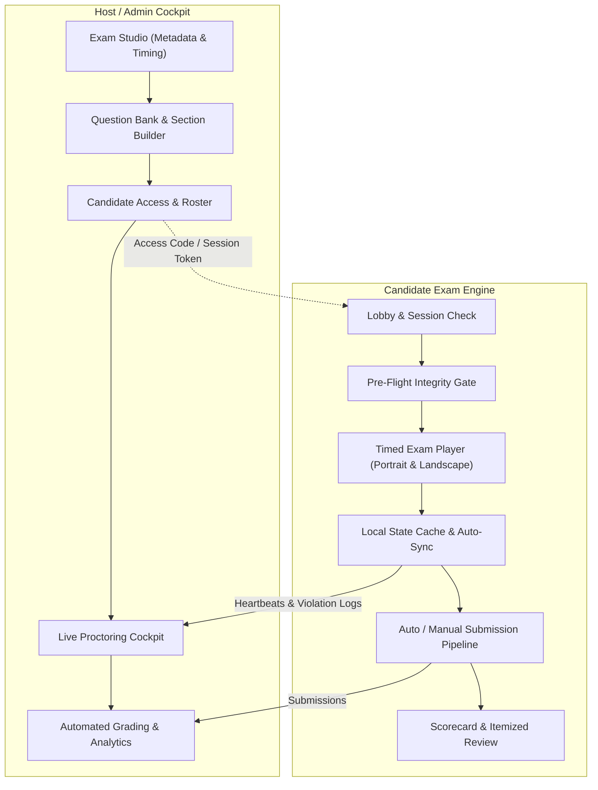
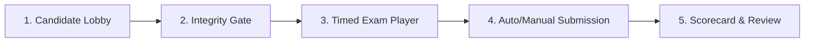
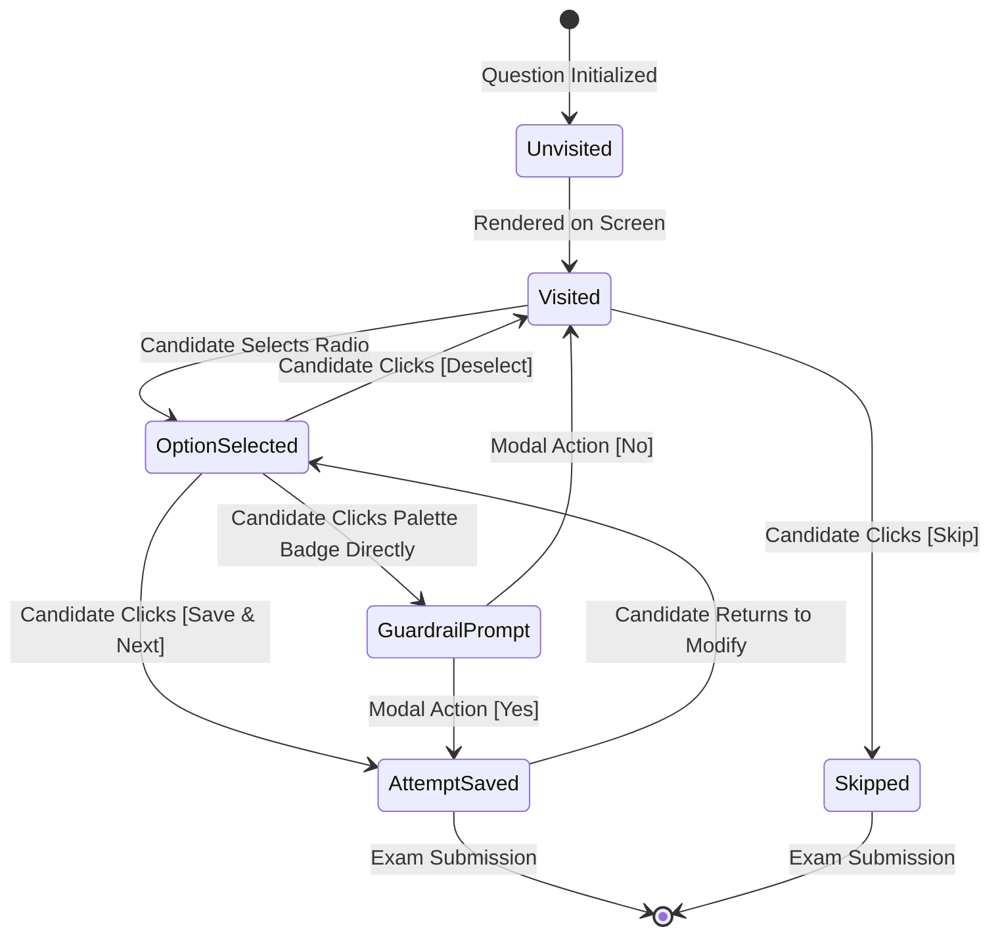
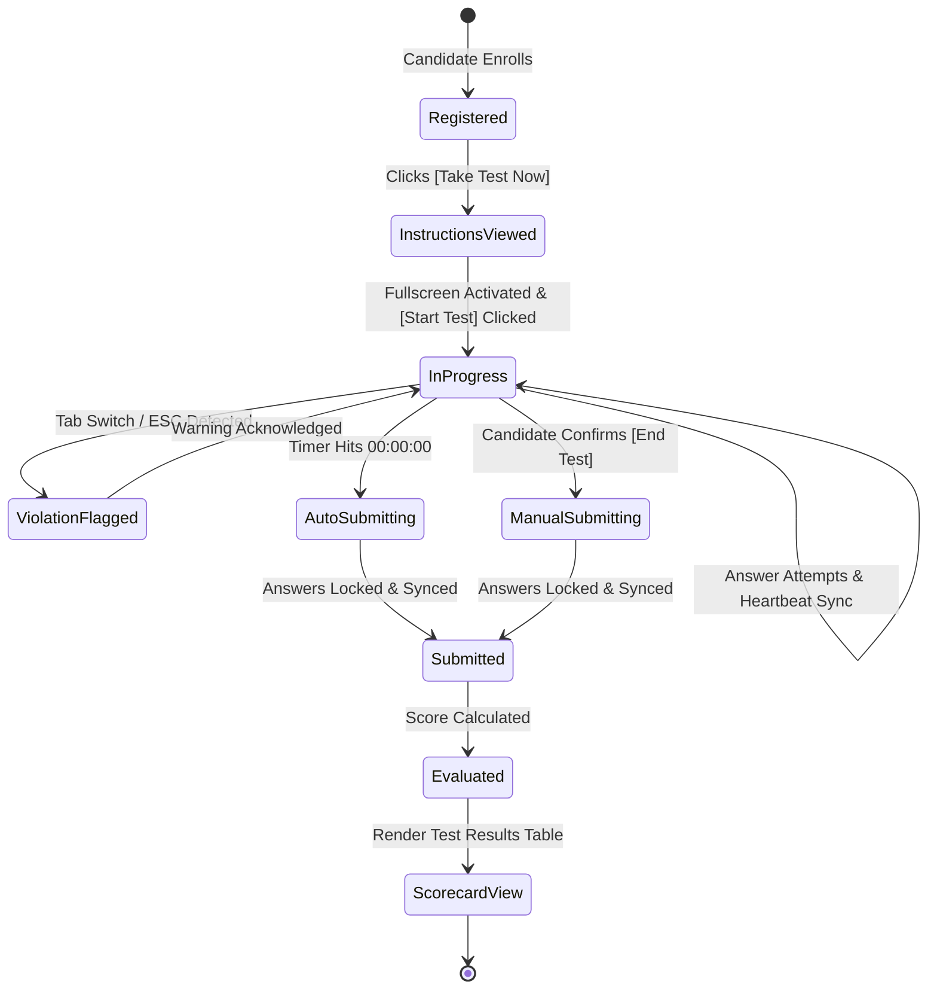

# OpenHall: Reverse-Engineered System Specification & AI Implementation Guide

> **Document Version:** 1.0.0  
> **Target Audience:** Autonomous AI Coding Agents, Full-Stack Architects, and Software Engineers  
> **Project Scope:** `OpenHall` — A modern, self-hosted web server and client application for authoring, hosting, proctoring, and conducting online examinations.  
> **Source Material:** Reverse-engineered from 180+ minutes of high-stakes online examination recordings and 37 cataloged visual artifacts in [`samples/screencasts/`](file:///c:/Users/debarkak/Documents/GitHub/openhall/samples/screencasts).

---

## 1. Executive Summary & Product Vision

**OpenHall** is a self-hosted, full-stack assessment platform engineered to solve two distinct workflows:
1. **The Host (Admin / Proctor):** A web cockpit to configure multi-section examinations, compose questions (with LaTeX equations, geometric figures, and data visualizations), set strict timing and marking policies, monitor active candidate sessions in real time, and inspect post-exam analytics.
2. **The Candidate (Examinee / Student):** A low-latency, responsive, distraction-free examination player designed to run reliably on desktop browsers, tablets, and mobile devices. It provides instant question switching, a visual status palette, dynamic countdown timing with visual progress gauges, automatic submission upon time expiry, and immediate score reporting.



---

## 2. Technical Stack Recommendation

To achieve instantaneous UI transitions, robust equation rendering, and real-time proctoring:

- **Frontend Framework:** Next.js (App Router) or Vite + React (TypeScript).
- **Styling & UI Components:** Tailwind CSS with Radix UI / shadcn/ui primitives.
- **Math & Science Rendering:** KaTeX or MathJax (for fast LaTeX formula rendering).
- **Icons & Graphics:** Lucide React + custom SVG circular progress gauges.
- **Backend & API:** Node.js (Next.js Server Actions / Route Handlers) or FastAPI / Go.
- **Database & ORM:** PostgreSQL or SQLite with Prisma ORM.
- **Real-Time Communication:** WebSockets (Socket.io) or Server-Sent Events (SSE) for proctor pings and session termination.
- **Client State Management:** Zustand or React Context with `localStorage` fallback to prevent data loss on page refresh.

---

## 3. Reverse-Engineered Exam Model & Domain Logic

Analysis of the examination sessions reveals the following baseline configuration:

| Dimension | Specification | Details / Behavior |
| :--- | :--- | :--- |
| **Duration** | 90 Minutes (5,400s) | Server-authoritative countdown; locks and auto-submits at `00:00:00`. |
| **Total Items** | 45 Questions | Multi-section modular structure. |
| **Section Architecture** | 3 Distinct Sections | • **Section 1: General Aptitude / Logic** (20 questions)<br>• **Section 2: Mathematics** (10 questions)<br>• **Section 3: Natural Sciences** (15 questions) |
| **Marking Weights** | +4.0 / 0.0 | • +4 marks for correct response.<br>• 0 deduction for incorrect response (customizable to -1 penalty for competitive modes).<br>• Max Possible Score: **180 marks**. |
| **Question Types** | Single-Choice MCQ | 4 mutually exclusive radio options; rich-text, LaTeX equations, or vector diagrams. |
| **Navigation Model** | Free-Navigation | Candidate can switch between sections and jump to any question at any point. |

---

## 4. Candidate Experience & User Interface Specification

The candidate experience consists of 5 core phases:



### 4.1 Phase 1: Candidate Lobby & Dashboard
- **Header:** Platform branding, user profile badge with initials (e.g. `DK`), logout/switch user.
- **Welcome Card:** Candidate greeting (`"Hey! [Candidate Name]"`), registration confirmation, and primary CTA: `[ Take Test Now ]`.
- **Secondary Actions:** Download links for Syllabus and Previous Question Papers.
- **Exam Series Carousel / Grid:**
  - Lists assigned examinations (e.g., Mock Test 1, Mock Test 2, Mock Test 3).
  - Status indicators: `[ Take Test ]` (Dark Navy CTA for pending tests) vs `[ Review Test ]` (Orange CTA for completed tests).
- *Visual Reference:* [`01_portal_exam_dashboard.png`](file:///c:/Users/debarkak/Documents/GitHub/openhall/samples/screencasts/01_portal_exam_dashboard.png), [`35_post_submission_portal_update.png`](file:///c:/Users/debarkak/Documents/GitHub/openhall/samples/screencasts/35_post_submission_portal_update.png).

---

### 4.2 Phase 2: Pre-Flight Integrity Gate & Instructions
Before the exam begins, candidates are presented with a modal/screen listing critical compliance rules:
1. **Fullscreen Lockdown:** The exam must run in full-screen mode (`document.documentElement.requestFullscreen()`). Exiting fullscreen triggers a violation.
2. **Keyboard Traps:** Pressing `ESC`, `Alt+Tab`, or browser navigation keys is intercepted and logged.
3. **Application & Tab Switching:** Window `blur` and `visibilitychange` events are tracked; switching away triggers warnings or automatic session termination.
4. **Single Active Device:** Concurrent sessions under the same credential are automatically invalidated.
5. **Pre-flight Launch Button:** A green `[ Start Test ]` button initiates the session, records `startedAt`, requests full-screen, and loads Section 1, Question 1.
- *Visual Reference:* [`02_pre_exam_instructions.png`](file:///c:/Users/debarkak/Documents/GitHub/openhall/samples/screencasts/02_pre_exam_instructions.png).

---

### 4.3 Phase 3: The Timed Exam Player (Core Interface)

The Exam Player adapts responsively into two ergonomic configurations:
- **Portrait View (Tablet / Mobile):** Stacked vertical layout. Header and section tabs on top, active question in center, sticky action bar, and question palette grid below.
- **Landscape View (Desktop / Widescreen):** Split 2-column layout. Left 70% viewport allocated to Question Stem and Options; Right 30% sidebar allocated to Section Header, Timer, and Question Palette Matrix.
- *Visual Reference:* [`03_exam_start_mat_q1.png`](file:///c:/Users/debarkak/Documents/GitHub/openhall/samples/screencasts/03_exam_start_mat_q1.png) (Portrait) and [`31_landscape_mode_mat_q19.png`](file:///c:/Users/debarkak/Documents/GitHub/openhall/samples/screencasts/31_landscape_mode_mat_q19.png) (Landscape).

#### Player Anatomy & Sub-components:

#### 1. Header & Navigation Bar
- **Exam Title:** Bold left-aligned header (e.g., `Mock Test 2 - Grade 9`).
- **Read Instructions Trigger:** Text link opening the rules modal in-place without pausing the clock or clearing input.
- **End Test Button:** Prominent orange button (`#e04d01` / `#eb5a00`) allowing early manual submission with a confirmation prompt.
- **Countdown Timer & Circular Pie Gauge:**
  - Displays `Time left HH : MM : SS`.
  - Circular clock graphic (`40px x 40px`) with an SVG pie/donut wedge that fills as time elapses (100% blue fill at expiration).
  - *Visual Reference:* [`24_exam_timer_warning_final_seconds.png`](file:///c:/Users/debarkak/Documents/GitHub/openhall/samples/screencasts/24_exam_timer_warning_final_seconds.png), [`25_exam_auto_submit_trigger.png`](file:///c:/Users/debarkak/Documents/GitHub/openhall/samples/screencasts/25_exam_auto_submit_trigger.png).

#### 2. Section Selector Tabs
- Horizontal pill buttons representing subjects (e.g., `[ General Aptitude ]`, `[ Mathematics ]`, `[ Natural Sciences ]`).
- **Active State:** Soft cyan background (`#9cd2df`), rounded corners, dark text.
- **Inactive State:** Transparent/light background, grey text.
- Clicking a tab switches the question view to the first question of that section or preserves the last viewed question.

#### 3. Question Stem & Media Renderer
- **Question Index Pill:** Bold green badge (e.g. `Q19`) positioned beside the stem.
- **Text Rendering:** High-legibility typography with support for inline italics and bolding.
- **Mathematical Formulations (LaTeX):** Native rendering of complex fractions, square roots, matrices, and variables (e.g. `\frac{p + \sqrt{p^2-q^2}}{p - \sqrt{p^2-q^2}}`).
- **Visual Illustrations:** High-resolution responsive images for Venn diagrams, colored pie charts, geometric figures, and electrical circuits.
- *Visual Reference:* [`05_mat_q3_pie_chart_diagram.png`](file:///c:/Users/debarkak/Documents/GitHub/openhall/samples/screencasts/05_mat_q3_pie_chart_diagram.png), [`11_mat_q19_venn_diagram.png`](file:///c:/Users/debarkak/Documents/GitHub/openhall/samples/screencasts/11_mat_q19_venn_diagram.png), [`13_math_q1_algebraic_fraction.png`](file:///c:/Users/debarkak/Documents/GitHub/openhall/samples/screencasts/13_math_q1_algebraic_fraction.png).

#### 4. Option Selector (Radio Group)
- 4 mutually exclusive choices.
- **Unselected State:** 20px circular outline (`#cbd5e1`).
- **Hover State:** Subtle border darken (`#94a3b8`).
- **Selected State:** Filled cyan circle (`#0891b2`) with a sharp white checkmark icon inside.
- *Visual Reference:* [`04_mat_q2_option_selected.png`](file:///c:/Users/debarkak/Documents/GitHub/openhall/samples/screencasts/04_mat_q2_option_selected.png).

#### 5. Action Control Bar
A sticky bottom bar providing three unambiguous workflow buttons:
- **`[ Deselect ]` (Left):** Clears the candidate's selection on the current question without advancing.
- **`[ Skip ]` (Right-Center):** Advances to the next question leaving the current item unattempted.
- **`[ Save & Next ]` (Right):** Primary green button (`#7ab73a`); persists the selected choice to local state and server, updates the palette badge to green, and advances to the next question.
- *Visual Reference:* [`28_deselect_action_state.png`](file:///c:/Users/debarkak/Documents/GitHub/openhall/samples/screencasts/28_deselect_action_state.png), [`29_skip_action_navigation.png`](file:///c:/Users/debarkak/Documents/GitHub/openhall/samples/screencasts/29_skip_action_navigation.png).

#### 6. Question Palette Matrix
A 5-column grid of rectangular rounded badges representing all questions in the active section:
- **Badge Anatomy:** Compact rounded button containing label (e.g. `Q1`, `Q2`, ... `Q20`).
- **State Styling Rules:**
  - `UNVISITED / UNATTEMPTED`: Flat light grey background (`#f3f4f6`), dark text (`#374151`).
  - `CURRENT ACTIVE`: Crisp white background, 2px solid green border (`#7ab73a`), green text.
  - `ATTEMPTED & SAVED`: Light green filled background (`#e2f3d4`), green border, dark green text (`#166534`).
- Direct clicking on any badge jumps immediately to that question.
- *Visual Reference:* [`10_mat_q15_palette_progress.png`](file:///c:/Users/debarkak/Documents/GitHub/openhall/samples/screencasts/10_mat_q15_palette_progress.png), [`17_math_q10_math_completed.png`](file:///c:/Users/debarkak/Documents/GitHub/openhall/samples/screencasts/17_math_q10_math_completed.png).

#### 7. Unsaved Attempt Guardrail Modal
- **Trigger Condition:** Occurs when a candidate clicks a radio option (making a provisional selection) but clicks a question badge in the palette directly instead of clicking `[ Save & Next ]`.
- **Modal Content:**
  - Header: `✕ SAVE ATTEMPT`
  - Body: *"Save this question's attempt? Use [Save and Next] at the bottom to avoid this popup from appearing again."*
  - Actions:
    - `[ No ]`: Discards the unsaved option change and navigates to the requested question.
    - `[ Yes ]`: Saves the selected option, updates the badge to green, and navigates.
- *Visual Reference:* [`30_save_attempt_warning_modal.png`](file:///c:/Users/debarkak/Documents/GitHub/openhall/samples/screencasts/30_save_attempt_warning_modal.png).

---

### 4.4 Phase 4: Automated Submission Pipeline
- **Trigger:** Reaching `00:00:00` on the countdown timer or manual confirmation of `[ End Test ]`.
- **Action:**
  1. The UI instantly disables all input controls.
  2. A semi-transparent overlay renders with an orange circular radial spinner.
  3. All local cached answers are flushed to the server via `POST /api/sessions/:id/submit`.
  4. The candidate session status is updated from `IN_PROGRESS` to `SUBMITTED`.
  5. The client redirects to the Scorecard & Analytics View.
- *Visual Reference:* [`26_submission_loader_spinner.png`](file:///c:/Users/debarkak/Documents/GitHub/openhall/samples/screencasts/26_submission_loader_spinner.png).

---

### 4.5 Phase 5: Scorecard & Performance Analytics
Upon completion, the candidate is presented with an instant, transparent score summary:
- **Greeting Banner:** Confetti graphic, `"Congratulations, [Candidate Name]!"`, `"Your hard work & dedication paid off. Here is your Result."`
- **Performance Matrix Table:**
  | Metric Column | Example Value | Description |
  | :--- | :---: | :--- |
  | **Total Questions** | 45 | Total items in paper |
  | **Maximum Marks** | 180 | Maximum possible score ($45 \times 4$) |
  | **Questions Attempted** | 45 | Count of submitted responses |
  | **Correct Responses** | 29 | Items evaluated as correct |
  | **Incorrect Responses** | 16 | Items evaluated as incorrect |
  | **Unattempted Questions** | 0 | Items skipped or left blank |
  | **Your Score** | **116 / 180** | Net score calculated by evaluation engine |
- **Navigation Action:** `< Back Home` returns candidate to the main dashboard where the test card now displays `[ Review Test ]`.
- *Visual Reference:* [`36_exam_results_scorecard.png`](file:///c:/Users/debarkak/Documents/GitHub/openhall/samples/screencasts/36_exam_results_scorecard.png), [`37_results_view_detailed.png`](file:///c:/Users/debarkak/Documents/GitHub/openhall/samples/screencasts/37_results_view_detailed.png).

---

## 5. Host & Administrative Cockpit Specification

The Host / Admin portal gives educators and test conductors complete governance over the assessment lifecycle.

### 5.1 Exam Studio (Configuration & Scheduling)
- **Metadata Management:** Title, subtitle, instructions (Markdown supported), target grade/group.
- **Timing & Schedule Engine:** Global duration (minutes), fixed start/end scheduling window or on-demand self-paced window.
- **Marking Scheme Rules:**
  - Positive score per correct question (Default: `+4.0`).
  - Negative penalty per incorrect response (Default: `0.0`, optional `-1.0` or `-0.25`).
  - Unattempted penalty (Default: `0.0`).
- **Access Control:** Generation of unique alphanumeric Exam Access Codes and public/private invite URLs.

### 5.2 Section & Question Bank Authoring
- **Hierarchical Tree:** Exam -> Add/Reorder Sections -> Add/Reorder Questions.
- **Rich Question Composer:**
  - WYSIWYG text editor with KaTeX math equation shortcut toolbar (`\frac`, `\sqrt`, `^`, `_`).
  - Drag-and-drop image uploader for diagrams, charts, and figures with automated compression and CDN storage.
  - Dynamic option builder (2 to 6 choices) with a radio selector to designate the authoritative answer key.
  - Solution explanation editor for post-exam candidate review.

### 5.3 Live Proctoring Cockpit (Real-Time Monitor)
A live operations dashboard displaying active examinees connected to the host's exam:
- **Candidate Table:** Name, email, IP address, device, start time, remaining time, current question index, total attempted count.
- **Violation Telemetry:** Real-time counters for:
  - Fullscreen exit events.
  - Window blur / tab switch events.
  - Multiple monitor detection flags.
- **Host Intervention Actions:**
  - `[ Extend Time ]` (+5m, +10m, +15m).
  - `[ Send Direct Warning ]` (Pushes an urgent banner to candidate's screen).
  - `[ Force Submit Session ]` (Terminates and grades the session immediately).

### 5.4 Evaluation & Analytics Engine
- **Automated Instant Grading:** Computes total marks, percentage, percentile, and section-by-section breakdown.
- **Item Difficulty Analysis:** Identifies questions with high error rates to help hosts evaluate question clarity.
- **Data Export:** Instant export of full gradebooks to CSV, Excel, and candidate PDF scorecards.

---

## 6. Algorithmic State Machines

### 6.1 Question Attempt Lifecycle State Machine



### 6.2 Exam Session Lifecycle



---

## 7. Database Schema (Prisma ORM)

```prisma
datasource db {
  provider = "postgresql"
  url      = env("DATABASE_URL")
}

generator client {
  provider = "prisma-client-js"
}

enum Role {
  ADMIN
  PROCTOR
  CANDIDATE
}

enum SessionStatus {
  NOT_STARTED
  IN_PROGRESS
  SUBMITTED
  EVALUATED
  DISQUALIFIED
}

enum ItemStatus {
  UNVISITED
  VISITED
  ANSWERED
  SKIPPED
}

model User {
  id           String        @id @default(cuid())
  email        String        @unique
  name         String
  role         Role          @default(CANDIDATE)
  createdAt    DateTime      @default(now())
  updatedAt    DateTime      @updatedAt
  hostedExams  Exam[]        @relation("HostRelation")
  sessions     ExamSession[]
}

model Exam {
  id              String        @id @default(cuid())
  title           String
  description     String?
  instructions    String?       @db.Text
  durationMinutes Int           @default(90)
  correctMarks    Float         @default(4.0)
  negativeMarks   Float         @default(0.0)
  isLive          Boolean       @default(false)
  accessCode      String        @unique
  hostId          String
  host            User          @relation("HostRelation", fields: [hostId], references: [id])
  sections        Section[]
  sessions        ExamSession[]
  createdAt       DateTime      @default(now())
  updatedAt       DateTime      @updatedAt
}

model Section {
  id         String     @id @default(cuid())
  examId     String
  exam       Exam       @relation(fields: [examId], references: [id], onDelete: Cascade)
  title      String     // e.g. "General Aptitude", "Mathematics", "Natural Sciences"
  orderIndex Int        @default(0)
  questions  Question[]
}

model Question {
  id         String            @id @default(cuid())
  sectionId  String
  section    Section           @relation(fields: [sectionId], references: [id], onDelete: Cascade)
  orderIndex Int               @default(0)
  stem       String            @db.Text // Supports Markdown & KaTeX: $\frac{a}{b}$
  diagramUrl String?
  options    Option[]
  attempts   QuestionAttempt[]
}

model Option {
  id         String            @id @default(cuid())
  questionId String
  question   Question          @relation(fields: [questionId], references: [id], onDelete: Cascade)
  orderIndex Int               @default(0)
  text       String            @db.Text
  imageUrl   String?
  isCorrect  Boolean           @default(false) // Never sent to examinee client during exam
  attempts   QuestionAttempt[]
}

model ExamSession {
  id           String            @id @default(cuid())
  examId       String
  exam         Exam              @relation(fields: [examId], references: [id])
  candidateId  String
  candidate    User              @relation(fields: [candidateId], references: [id])
  status       SessionStatus     @default(NOT_STARTED)
  startedAt    DateTime?
  submittedAt  DateTime?
  totalScore   Float?
  attempts     QuestionAttempt[]
  proctorLogs  ProctorLog[]
  createdAt    DateTime          @default(now())
  updatedAt    DateTime          @updatedAt
}

model QuestionAttempt {
  id             String      @id @default(cuid())
  sessionId      String
  session        ExamSession @relation(fields: [sessionId], references: [id], onDelete: Cascade)
  questionId     String
  question       Question    @relation(fields: [questionId], references: [id])
  selectedOption Option?     @relation(fields: [optionId], references: [id])
  optionId       String?
  status         ItemStatus  @default(UNVISITED)
  updatedAt      DateTime    @updatedAt

  @@unique([sessionId, questionId])
}

model ProctorLog {
  id        String      @id @default(cuid())
  sessionId String
  session   ExamSession @relation(fields: [sessionId], references: [id], onDelete: Cascade)
  eventType String      // "FULLSCREEN_EXIT", "TAB_BLUR", "KEY_ESCAPE", "MULTIPLE_WINDOWS"
  timestamp DateTime    @default(now())
  metadata  Json?
}
```

---

## 8. REST & WebSocket API Specification

### 8.1 Candidate Endpoints
- `GET /api/exams/:accessCode/lobby` — Returns exam metadata, title, instructions, and candidate attempt status.
- `POST /api/sessions/start` — Initializes a candidate session, locks device, sets `startedAt`, returns question manifest (with option keys excluded).
- `POST /api/sessions/:id/attempt` — Saves an answer for a question (`{ questionId, optionId, status }`).
- `POST /api/sessions/:id/proctor-event` — Logs integrity violations (`{ eventType: "TAB_BLUR" }`).
- `POST /api/sessions/:id/submit` — Finalizes and evaluates the exam.
- `GET /api/sessions/:id/scorecard` — Returns the evaluated scorecard metrics.

### 8.2 Host / Admin Endpoints
- `POST /api/admin/exams` — Creates a new exam with sections and marking rules.
- `POST /api/admin/sections/:id/questions` — Adds questions with LaTeX formulas, option keys, and diagrams.
- `GET /api/admin/exams/:id/live-roster` — Returns all active candidate sessions with remaining times and proctor violation counts.
- `POST /api/admin/sessions/:id/force-submit` — Host-triggered remote submission.
- `GET /api/admin/exams/:id/analytics` — Generates aggregated score distribution and item difficulty reports.

---

## 9. Visual Artifact Reference Directory

All 37 high-resolution frames extracted from the examination recordings are indexed below for direct design reference:

| Screen Identifier | Artifact Path | Key UI & Interaction Elements Captured |
| :--- | :--- | :--- |
| **Lobby 01** | [`01_portal_exam_dashboard.png`](file:///c:/Users/debarkak/Documents/GitHub/openhall/samples/screencasts/01_portal_exam_dashboard.png) | Candidate welcome card, `Take Test Now` CTA, test cards, syllabus downloads. |
| **Instructions 02** | [`02_pre_exam_instructions.png`](file:///c:/Users/debarkak/Documents/GitHub/openhall/samples/screencasts/02_pre_exam_instructions.png) | Anti-cheat guidelines card, fullscreen requirement, `Start Test` trigger. |
| **Exam Player 03** | [`03_exam_start_mat_q1.png`](file:///c:/Users/debarkak/Documents/GitHub/openhall/samples/screencasts/03_exam_start_mat_q1.png) | Initial exam state, 90-min countdown (`01:29:57`), Section 1 Q1, question palette. |
| **Option Selection 04** | [`04_mat_q2_option_selected.png`](file:///c:/Users/debarkak/Documents/GitHub/openhall/samples/screencasts/04_mat_q2_option_selected.png) | Cyan checkmark selected radio state, active `Save & Next` button. |
| **Data Interpretation 05** | [`05_mat_q3_pie_chart_diagram.png`](file:///c:/Users/debarkak/Documents/GitHub/openhall/samples/screencasts/05_mat_q3_pie_chart_diagram.png) | Image diagram rendering: multi-colored pie chart data interpretation item. |
| **Word Problem 06** | [`06_mat_q4_age_problem.png`](file:///c:/Users/debarkak/Documents/GitHub/openhall/samples/screencasts/06_mat_q4_age_problem.png) | Multi-line text word problem layout and typography spacing. |
| **Cipher Logic 07** | [`07_mat_q7_coding_decoding.png`](file:///c:/Users/debarkak/Documents/GitHub/openhall/samples/screencasts/07_mat_q7_coding_decoding.png) | Coded language substitution question with letter sequences. |
| **Navigation Problem 08** | [`08_mat_q9_directions_navigation.png`](file:///c:/Users/debarkak/Documents/GitHub/openhall/samples/screencasts/08_mat_q9_directions_navigation.png) | Directional compass problem layout. |
| **Series Logic 09** | [`09_mat_q12_number_series.png`](file:///c:/Users/debarkak/Documents/GitHub/openhall/samples/screencasts/09_mat_q12_number_series.png) | Numerical pattern and sequence reasoning question. |
| **Palette Progress 10** | [`10_mat_q15_palette_progress.png`](file:///c:/Users/debarkak/Documents/GitHub/openhall/samples/screencasts/10_mat_q15_palette_progress.png) | Progress state: 14 attempted green badges, active badge border, unvisited badges. |
| **Venn Diagram 11** | [`11_mat_q19_venn_diagram.png`](file:///c:/Users/debarkak/Documents/GitHub/openhall/samples/screencasts/11_mat_q19_venn_diagram.png) | Graphical radio options with intersecting set circle diagrams. |
| **Section Complete 12** | [`12_mat_q20_section_end.png`](file:///c:/Users/debarkak/Documents/GitHub/openhall/samples/screencasts/12_mat_q20_section_end.png) | Last question of Section 1 (20/20 answered). |
| **Math / KaTeX 13** | [`13_math_q1_algebraic_fraction.png`](file:///c:/Users/debarkak/Documents/GitHub/openhall/samples/screencasts/13_math_q1_algebraic_fraction.png) | Section switch to Mathematics; LaTeX radical fraction $\frac{p+\sqrt{p^2-q^2}}{p-\sqrt{p^2-q^2}}$. |
| **Polynomials 14** | [`14_math_q3_polynomials.png`](file:///c:/Users/debarkak/Documents/GitHub/openhall/samples/screencasts/14_math_q3_polynomials.png) | Algebraic expressions and polynomial equations. |
| **Geometry Theorem 15** | [`15_math_q5_geometry_theorem.png`](file:///c:/Users/debarkak/Documents/GitHub/openhall/samples/screencasts/15_math_q5_geometry_theorem.png) | Geometric angles, circle theorems, and Euclidean proofs. |
| **Coordinate Geometry 16** | [`16_math_q8_coordinate_geometry.png`](file:///c:/Users/debarkak/Documents/GitHub/openhall/samples/screencasts/16_math_q8_coordinate_geometry.png) | Coordinate geometry items. |
| **Math Palette Complete 17** | [`17_math_q10_math_completed.png`](file:///c:/Users/debarkak/Documents/GitHub/openhall/samples/screencasts/17_math_q10_math_completed.png) | Full Section 2 palette (Q1 to Q10) in green answered state. |
| **Science Switch 18** | [`18_science_q1_physics_motion.png`](file:///c:/Users/debarkak/Documents/GitHub/openhall/samples/screencasts/18_science_q1_physics_motion.png) | Section switch to Science; Physics kinematics and motion. |
| **Chemical Reaction 19** | [`19_science_q4_chemistry_reaction.png`](file:///c:/Users/debarkak/Documents/GitHub/openhall/samples/screencasts/19_science_q4_chemistry_reaction.png) | Chemical formulas and reaction stoichiometry. |
| **Compounds 20** | [`20_science_q6_chemistry_compounds.png`](file:///c:/Users/debarkak/Documents/GitHub/openhall/samples/screencasts/20_science_q6_chemistry_compounds.png) | Chemistry elements vs compounds multiple choice. |
| **Biology 21** | [`21_science_q9_biology_cells.png`](file:///c:/Users/debarkak/Documents/GitHub/openhall/samples/screencasts/21_science_q9_biology_cells.png) | Biology cell biology and organelle functions. |
| **Science Diagram 22** | [`22_science_q12_diagram_question.png`](file:///c:/Users/debarkak/Documents/GitHub/openhall/samples/screencasts/22_science_q12_diagram_question.png) | Experimental setup and scientific diagram rendering. |
| **All Attempted 23** | [`23_science_q15_all_attempted.png`](file:///c:/Users/debarkak/Documents/GitHub/openhall/samples/screencasts/23_science_q15_all_attempted.png) | Final question of the paper; all 45 badges green. |
| **Timer Warning 24** | [`24_exam_timer_warning_final_seconds.png`](file:///c:/Users/debarkak/Documents/GitHub/openhall/samples/screencasts/24_exam_timer_warning_final_seconds.png) | Timer at `00:00:02`; circular clock progress gauge completely filled. |
| **Auto-Submit 25** | [`25_exam_auto_submit_trigger.png`](file:///c:/Users/debarkak/Documents/GitHub/openhall/samples/screencasts/25_exam_auto_submit_trigger.png) | Timer reaches `00:00:00`; instant auto-submit trigger. |
| **Loading Spinner 26** | [`26_submission_loader_spinner.png`](file:///c:/Users/debarkak/Documents/GitHub/openhall/samples/screencasts/26_submission_loader_spinner.png) | Centered circular loading spinner during submission sync. |
| **Test 2 Launch 27** | [`27_mock2_start_coin_ratio.png`](file:///c:/Users/debarkak/Documents/GitHub/openhall/samples/screencasts/27_mock2_start_coin_ratio.png) | Alternative test series start state with coin ratio question. |
| **Deselect Action 28** | [`28_deselect_action_state.png`](file:///c:/Users/debarkak/Documents/GitHub/openhall/samples/screencasts/28_deselect_action_state.png) | Option selected with active `[ Deselect ]` action button. |
| **Skip Action 29** | [`29_skip_action_navigation.png`](file:///c:/Users/debarkak/Documents/GitHub/openhall/samples/screencasts/29_skip_action_navigation.png) | Navigating forward leaving question unattempted. |
| **Guardrail Modal 30** | [`30_save_attempt_warning_modal.png`](file:///c:/Users/debarkak/Documents/GitHub/openhall/samples/screencasts/30_save_attempt_warning_modal.png) | `SAVE ATTEMPT` confirmation dialog on direct palette jump. |
| **Landscape Mode 31** | [`31_landscape_mode_mat_q19.png`](file:///c:/Users/debarkak/Documents/GitHub/openhall/samples/screencasts/31_landscape_mode_mat_q19.png) | Widescreen / desktop 2-column layout (Question left, Palette right). |
| **Landscape Science 32** | [`32_landscape_mode_science_section.png`](file:///c:/Users/debarkak/Documents/GitHub/openhall/samples/screencasts/32_landscape_mode_science_section.png) | Landscape mode across section tab switch. |
| **Landscape Compounds 33** | [`33_landscape_science_q6_compounds.png`](file:///c:/Users/debarkak/Documents/GitHub/openhall/samples/screencasts/33_landscape_science_q6_compounds.png) | Option selection and status in landscape mode. |
| **Landscape Zero 34** | [`34_landscape_timer_countdown_zero.png`](file:///c:/Users/debarkak/Documents/GitHub/openhall/samples/screencasts/34_landscape_timer_countdown_zero.png) | Countdown timer at `00:00:00` in landscape mode. |
| **Portal Status Update 35** | [`35_post_submission_portal_update.png`](file:///c:/Users/debarkak/Documents/GitHub/openhall/samples/screencasts/35_post_submission_portal_update.png) | Post-submission dashboard with updated `[ Review Test ]` action. |
| **Scorecard Matrix 36** | [`36_exam_results_scorecard.png`](file:///c:/Users/debarkak/Documents/GitHub/openhall/samples/screencasts/36_exam_results_scorecard.png) | Test results table: Total (45), Max Marks (180), Attempted (45), Score (116/180). |
| **Detailed Results 37** | [`37_results_view_detailed.png`](file:///c:/Users/debarkak/Documents/GitHub/openhall/samples/screencasts/37_results_view_detailed.png) | Scrolled scorecard view with `< Back Home` navigation link. |

---

## 10. AI Coding Agent Step-by-Step Implementation Plan

To build **OpenHall**, execute in the following 6 sequential phases:

### Phase 1: Database & Backend Foundations
1. Initialize Prisma schema using the data models defined in **Section 7**.
2. Seed initial mock test data (45 questions across 3 sections with KaTeX formulas and diagrams).
3. Create API routes for session management (`/api/sessions/start`, `/api/sessions/:id/attempt`, `/api/sessions/:id/submit`).

### Phase 2: Exam Player Core & Responsive Layout
1. Implement the responsive 2-column layout for desktop/landscape and stacked layout for mobile/portrait.
2. Build the top navigation bar with exam title, instructions link, and `[ End Test ]` button.
3. Build the Section Tabs component with active/inactive styling.
4. Build the Question Card with KaTeX equation rendering and diagram image display.
5. Build the Radio Option Selector with unselected circle and cyan checked indicator.

### Phase 3: Action Controls & Question Palette State Machine
1. Implement `[ Deselect ]`, `[ Skip ]`, and `[ Save & Next ]` button handlers.
2. Build the Question Palette Badge Grid (5 columns) with the 4 visual states (Unvisited, Visited, Active, Answered).
3. Implement the `SAVE ATTEMPT` guardrail modal when jumping via palette badges with uncommitted selections.

### Phase 4: Timer Engine & Auto-Submit Pipeline
1. Create a synchronized countdown timer hook with SVG pie progress gauge.
2. Hook timer expiry (`00:00:00`) to automatically trigger session submission.
3. Add full-screen lockdown and integrity event listeners (`visibilitychange`, `blur`, `keydown` trap).

### Phase 5: Scorecard & Candidate Results
1. Create post-submission evaluation handler calculating correct/incorrect marks.
2. Render the celebratory scorecard screen with the performance metric table and `< Back Home` navigation.

### Phase 6: Host Admin Cockpit & Real-Time Monitoring
1. Build the Admin Exam Studio for creating exams and authoring questions with LaTeX stems.
2. Build the Live Proctoring dashboard with real-time candidate heartbeat, remaining time, and tab-switch violation logs.
